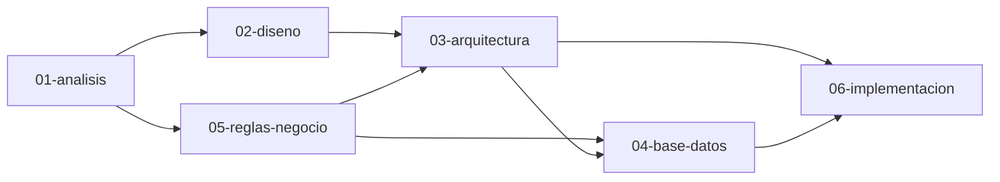

# Índice General de Documentación
## FORJA BRAVA — SIGR (Sistema Integral de Gestión de Restaurante)

**Producto:** FORJA BRAVA — SIGR (*El sabor que se hace a fuego.*)  
**Versión de documentación:** 3.0 — Diseño UI/UX Integral y Arquitectura Base  
**Propósito:** Proveer la especificación técnica, funcional, visual, de arquitectura y de base de datos directamente utilizable para iniciar la construcción evolutiva de FORJA BRAVA — SIGR sin improvisación, conservando la base frontend y la identidad visual existentes.

---

## 1. Principio rector y fuentes de verdad

Esta documentación consolida y organiza en un repositorio técnico estructurado:
1. El estado real comprobado del repositorio (`index.html`, `admin.html`, `css/`, `js/`, `assets/`, `package.json`).
2. Los hallazgos de la auditoría técnica integral (QSTI) y la auditoría de diseño/funcionalidades (TAREA 01).
3. El documento maestro previo (`docs/auditorias/auditoria-diseno-funcional.md`) y los documentos de trabajo de diseño (`docs/diseno/`), que se conservan intactos como referencia histórica.
4. Las decisiones funcionales definitivas **D-01 a D-06** y el stack tecnológico objetivo (**React + Vite + Tailwind CSS v4 + Zod + ESLint + Supabase/PostgreSQL + Vitest + Playwright + GitHub Actions + Vercel**).

---

## 2. Mapa de la estructura documental (`docs/`)

### 01. Análisis y Alcance (`docs/01-analisis/`)
Establece el punto de partida comprobable del software y delimita qué se conserva, qué se mejora, qué se reutiliza y qué se construye.
- [`01-analisis/estado-actual.md`](./01-analisis/estado-actual.md): Diagnóstico técnico y visual del código actual, brechas, riesgos críticos y discrepancias verificadas en el repositorio.
- [`01-analisis/alcance-funcional.md`](./01-analisis/alcance-funcional.md): Alcance funcional completo de las 4 experiencias, decisiones aprobadas **D-01 a D-06**, reglas transversales y supuestos pendientes.
- [`01-analisis/inventario-funcionalidades.md`](./01-analisis/inventario-funcionalidades.md): Matriz completa de funcionalidades y módulos clasificados por estado real y estrategia de evolución (`CONSERVAR`, `MEJORAR`, `REUTILIZAR`, `CREAR`, `MIGRAR/REEMPLAZAR`).

### 02. Diseño UI/UX (`docs/02-diseno/`)
Especifica de forma concreta el sistema visual y cada pantalla del producto (con sus 18 dimensiones obligatorias).
- [`02-diseno/sistema-diseno.md`](./02-diseno/sistema-diseno.md): Paleta oficial, tipografía, jerarquías, bordes, espaciados, responsive, accesibilidad e impresión.
- [`02-diseno/componentes-ui.md`](./02-diseno/componentes-ui.md): Catálogo de componentes compartidos (existentes reutilizables y nuevos), variantes, estados y props conceptuales.
- [`02-diseno/mapa-navegacion.md`](./02-diseno/mapa-navegacion.md): Definición completa de rutas React, layouts, protección por rol y redirecciones.
- [`02-diseno/flujos-usuario.md`](./02-diseno/flujos-usuario.md): Diagramas Mermaid y recorridos de usuario de extremo a extremo para los procesos clave.
- [`02-diseno/sitio-publico.md`](./02-diseno/sitio-publico.md): Especificación individual de las pantallas públicas (`Inicio`, `Menú`, `Categorías`, `Detalle de producto`, `Carrito`, `Checkout`, `Reservas`, `Contacto`, `Login`, `Registro`).
- [`02-diseno/experiencia-cliente.md`](./02-diseno/experiencia-cliente.md): Especificación de `Dashboard`, `Perfil`, `Direcciones`, `Pedidos`, `Detalle`, `Seguimiento`, `Reservas`, `Historial` y `Checkout`.
- [`02-diseno/experiencia-mesero.md`](./02-diseno/experiencia-mesero.md): Especificación de `Dashboard operativo`, `Mapa de mesas`, `Detalle de mesa`, `Selector/Comanda`, `Pedidos registrados`, `Cuenta acumulada` y `Solicitud de cierre`.
- [`02-diseno/experiencia-administrador.md`](./02-diseno/experiencia-administrador.md): Especificación de `Dashboard`, `Productos`, `Crear/Editar producto`, `Categorías`, `Pedidos`, `Reservas/Calendario`, `Mesas`, `Usuarios/Roles`, `Caja` (apertura, movimientos, cierre), `Reportes`, `Configuración` y `Auditoría`.

### 03. Arquitectura Base (`docs/03-arquitectura/`)
Define la solución técnica objetivo y cómo migrar progresivamente sin desechar la base útil.
- [`03-arquitectura/arquitectura-general.md`](./03-arquitectura/arquitectura-general.md): Capas, responsabilidades, comunicación cliente-servidor, dominios y manejo transversal de errores.
- [`03-arquitectura/arquitectura-frontend.md`](./03-arquitectura/arquitectura-frontend.md): Estructura React + Vite + Tailwind CSS v4 + Zod, estado, servicios y reutilización del diseño actual.
- [`03-arquitectura/arquitectura-backend.md`](./03-arquitectura/arquitectura-backend.md): Arquitectura BaaS con Supabase (Auth, PostgreSQL, Storage, Realtime, RPCs SQL y criterio de Edge Functions).
- [`03-arquitectura/autenticacion-autorizacion.md`](./03-arquitectura/autenticacion-autorizacion.md): Flujos de identidad, matriz completa de permisos por rol (`cliente`, `mesero`, `administrador`) y políticas RLS.
- [`03-arquitectura/persistencia.md`](./03-arquitectura/persistencia.md): Estrategia de persistencia híbrida (PostgreSQL vs. `localStorage` solo para carrito temporal), sincronización Realtime y migración de datos.
- [`03-arquitectura/seguridad.md`](./03-arquitectura/seguridad.md): Controles de seguridad por diseño, prevención de XSS/manipulación de precios, secretos, cabeceras HTTP y protección de PII.

### 04. Base de Datos PostgreSQL (`docs/04-base-datos/`)
Define el modelo relacional completo antes de escribir migraciones SQL.
- [`04-base-datos/modelo-entidad-relacion.md`](./04-base-datos/modelo-entidad-relacion.md): Diagrama ER en Mermaid, relaciones cardinales y separación entre cuentas de mesa y pedidos individuales.
- [`04-base-datos/diccionario-datos.md`](./04-base-datos/diccionario-datos.md): Especificación detallada de las 18 tablas (columnas, tipos PostgreSQL, PK, FK, checks, índices y políticas RLS).
- [`04-base-datos/reglas-integridad.md`](./04-base-datos/reglas-integridad.md): Controles transaccionales para evitar duplicación de pedidos, solapamiento de reservas, alteración de precios y doble contabilización de pagos.

### 05. Reglas de Negocio (`docs/05-reglas-negocio/`)
Detalla las reglas operativas sin ambigüedades por dominio funcional.
- [`05-reglas-negocio/pedidos.md`](./05-reglas-negocio/pedidos.md): Modalidades, estados, transiciones por rol, snapshots y cancelaciones.
- [`05-reglas-negocio/reservas.md`](./05-reglas-negocio/reservas.md): Algoritmo de disponibilidad, duración configurable (D-02), asignación automática de mesas y cancelaciones.
- [`05-reglas-negocio/mesas.md`](./05-reglas-negocio/mesas.md): Inventario dinámico (D-01), zonas, estados, ocupación y cuentas acumuladas (D-04).
- [`05-reglas-negocio/pagos-simulados.md`](./05-reglas-negocio/pagos-simulados.md): Comportamiento de `Efectivo`, `Tarjeta`, `Nequi` y `PSE`, estados independientes y avisos obligatorios.
- [`05-reglas-negocio/caja-reportes.md`](./05-reglas-negocio/caja-reportes.md): Apertura, base inicial, cobro de cuentas de mesa, ingresos/egresos, arqueo, cierre y métricas de reportes.

### 06. Plan de Implementación (`docs/06-implementacion/`)
Hoja de ruta priorizada para construir el sistema por etapas verificables.
- [`06-implementacion/estructura-proyecto.md`](./06-implementacion/estructura-proyecto.md): Árbol objetivo del repositorio React + Vite + Supabase + Tests + CI/CD.
- [`06-implementacion/plan-desarrollo.md`](./06-implementacion/plan-desarrollo.md): Plan en 13 etapas ordenadas por dependencias reales, entregables y criterios de salida.
- [`06-implementacion/criterios-aceptacion.md`](./06-implementacion/criterios-aceptacion.md): Criterios de aceptación transversales (funcionales, seguridad, rendimiento, accesibilidad, pruebas y despliegue).

---

## 3. Relación entre documentos y orden de lectura recomendado

