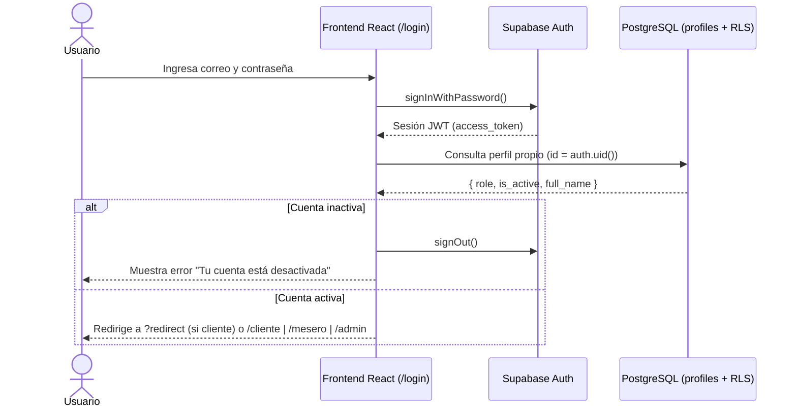
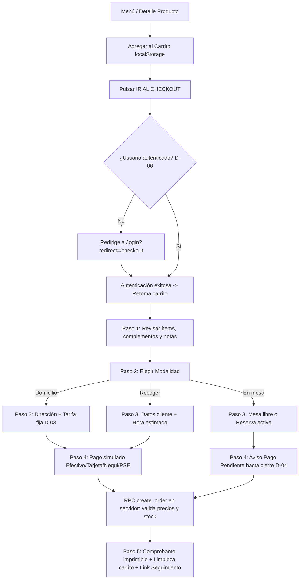
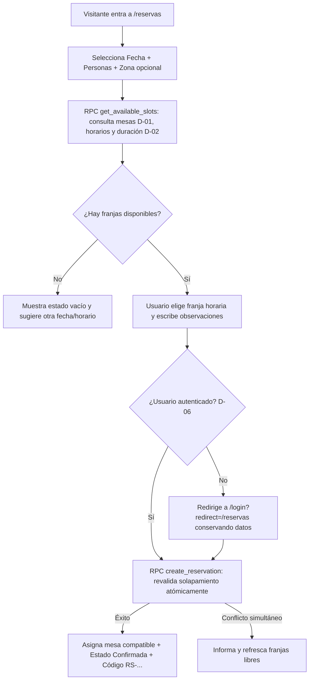
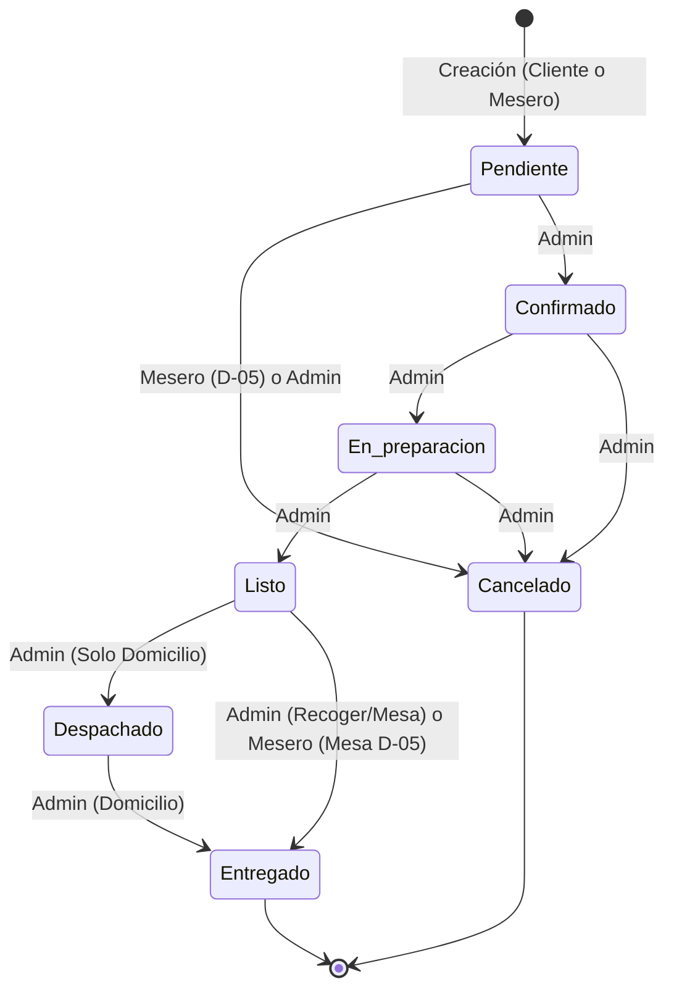

# Flujos de Usuario y Recorridos Operativos
## FORJA BRAVA — SIGR

Este documento visualiza mediante diagramas Mermaid y secuencias concretas los recorridos de usuario de las cuatro experiencias, asegurando coherencia entre diseño UI/UX, reglas de negocio y seguridad.

---

## 1. Flujo de Autenticación y Redirección por Rol (D-06)



---

## 2. Flujo de Compra Online: Domicilio, Recoger y Mesa (`CLI-05`)



---

## 3. Flujo de Reserva Pública con Confirmación Automática (D-01, D-02, D-06)



---

## 4. Flujo Operativo del Mesero y Cierre de Cuenta en Caja (D-04, D-05)

```mermaid
sequenceDiagram
    actor M as Mesero
    actor A as Administrador (Preparación y Caja)
    participant DB as Supabase PostgreSQL

    M->>DB: Selecciona Mesa #X -> Registra comanda (RPC create_table_order)
    DB-->>M: Mesa pasa a Ocupada; Pedido = Pendiente; Pago = Pendiente (D-04)
    Note over M: Si el pedido sigue en Pendiente, puede Cancelar (D-05)
    A->>DB: Actualiza preparación: Pendiente -> Confirmado -> En preparación -> Listo
    DB-->>M: Alerta Realtime: Pedido de Mesa #X Listo
    M->>DB: Marca pedido como Entregado (D-05)
    Note over M: Puede repetir comandas sobre la misma cuenta de mesa
    M->>DB: Solicita Cierre de Cuenta de Mesa #X (MES-05)
    A->>DB: En Caja (ADM-09) cobra cuenta consolidada (Efectivo/Digital simulado)
    DB-->>A: Registra pago único, vincula a turno de caja y libera Mesa #X -> Disponible
```

---

## 5. Ciclo de Estados y Trazabilidad de Pedidos


