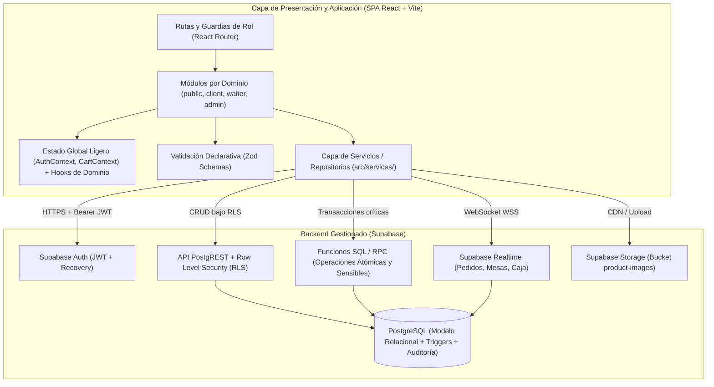

# Arquitectura General del Sistema
## FORJA BRAVA — SIGR

Define la arquitectura base objetivo para evolucionar el prototipo estático actual hacia una plataforma productiva basada en **React + Vite + Tailwind CSS v4 + Zod** en frontend y **Supabase (PostgreSQL + Auth + Storage + Realtime + RLS)** como backend gestionado (BaaS), sin incorporar frameworks de servidor adicionales (como Express) que no tienen justificación en esta etapa.

---

## 1. Vista de capas y comunicación

---

## 2. Separación de responsabilidades por capa

| Capa | Responsabilidad concreta | Qué NO debe hacer |
|---|---|---|
| **UI / Componentes (`src/features/`, `src/components/`)** | Renderizar vistas accesibles, capturar interacción, mostrar estados de carga/vacío/error y delegar acciones. | No ejecutar SQL ni consultas directas a `supabase.from(...)`, ni calcular precios definitivos de cobro. |
| **Validación (`src/schemas/`)** | Validar entradas de formularios y contratos con **Zod** antes de enviar peticiones. | No sustituir las restricciones `CHECK` ni las validaciones de servidor en PostgreSQL. |
| **Servicios (`src/services/`)** | Encapsular toda comunicación con `@supabase/supabase-js` (consultas, RPCs, Storage y suscripciones Realtime) y normalizar errores. | No contener lógica de presentación ni manipular DOM. |
| **Autorización y Datos (Supabase + PostgreSQL)** | Aplicar **RLS** por rol, recalcular precios en servidor (`create_order`), prevenir solapamiento de reservas (`create_reservation`), gestionar cierres de caja (`close_cash_session`) y registrar auditoría. | No depender de banderas del cliente (`isAdmin` o `price` enviado por frontend). |

---

## 3. Organización por dominios

El sistema se organiza en 8 dominios cohesivos que se reflejan de forma paralela en frontend (`src/features/`, `src/services/`), esquemas Zod y tablas PostgreSQL:
1. `auth` (identidad, sesiones, perfiles, roles y usuarios).
2. `catalog` (categorías, productos, complementos y producto destacado).
3. `cart` (carrito local temporal y cálculo de estimaciones).
4. `orders` (checkout, modalidades domicilio/recoger/mesa, estados y seguimiento).
5. `tables` (inventario de mesas, zonas, ocupación y cuentas de mesa).
6. `reservations` (disponibilidad automática, duración configurable y calendario).
7. `cash` (turnos de caja, pagos simulados, cobro de cuentas de mesa, movimientos, arqueo y reportes).
8. `settings` (configuración global del restaurante y auditoría).

---

## 4. Gestión transversal de errores

- Toda llamada en `src/services/` envuelve respuestas de Supabase en un contrato uniforme `{ data, error }` con códigos legibles (`AUTH_REQUIRED`, `FORBIDDEN_ROLE`, `OUT_OF_STOCK`, `SLOT_UNAVAILABLE`, `INVALID_TRANSITION`, `NETWORK_ERROR`).
- La UI traduce códigos a mensajes claros en español en `ToastNotice` o errores inline, nunca exponiendo trazas SQL crudas ni nombres internos de políticas al usuario final.
- Se define un `ErrorBoundary` de React en el nivel raíz y por layout para evitar pantallas en blanco ante excepciones inesperadas.
