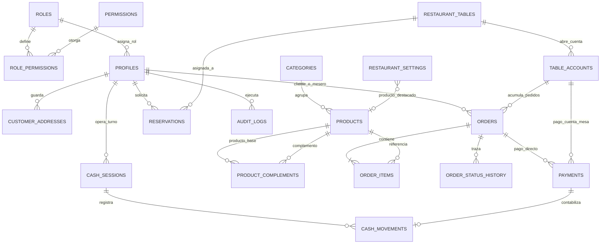

# Modelo Entidad-Relación (PostgreSQL / Supabase)
## FORJA BRAVA — SIGR

Diseño conceptual y lógico de la base de datos relacional PostgreSQL que soporta todos los módulos del SIGR y las decisiones **D-01 a D-06**, diferenciando explícitamente **cuentas de mesa (`table_accounts`)** de **pedidos individuales (`orders`)** y manteniendo snapshots históricos en `order_items`.

> *Nota:* Este documento define el diseño previo a la implementación; no genera migraciones ni ejecuta SQL en esta etapa.

---

## 1. Diagrama Entidad-Relación (Mermaid)

---

## 2. Decisiones clave de modelado relacional

1. **Separación entre `table_accounts` y `orders` (D-04):**
   - Una mesa (`restaurant_tables`) puede tener a lo sumo **una cuenta abierta o en solicitud de cierre** (`table_accounts` con `status IN ('open', 'closing_requested')`).
   - Cada comanda que toma el mesero (o el cliente en mesa) crea un registro independiente en `orders` apuntando a `table_account_id`, con `modality = 'mesa'` y `payment_status = 'pending'`.
   - Al cerrar la cuenta en Caja (`ADM-09`), se crea **un único registro en `payments`** vinculado a `table_account_id` (y se refleja una única entrada en `cash_movements`), evitando cobrar dos veces los pedidos acumulados.
2. **Snapshots inmutables en `order_items`:**
   - Cada línea guarda `product_id` (FK con `ON DELETE RESTRICT` para preservar integridad histórica), `product_name_snapshot`, `unit_price_snapshot` y `addons_snapshot (jsonb)`. Si el administrador edita o cambia el precio de "La Forjada" mañana, los pedidos y reportes históricos jamás se alteran.
3. **Relación explícita de complementos (`product_complements` + `products.is_addon`):**
   - Elimina definitivamente la heurística de expresión regular de `js/checkout.js` (`L7`).
4. **Identidad delegada a Supabase Auth:**
   - `public.profiles.id` referencia `1:1` a `auth.users(id)` (`ON DELETE CASCADE`), sin almacenar contraseñas ni hashes en tablas públicas.
5. **Restricción temporal en `reservations` (D-01 y D-02):**
   - Cada reserva almacena `start_at (timestamptz)` y `end_at (timestamptz)` calculado a partir de `restaurant_settings.reservation_duration_minutes`, permitiendo impedir solapamientos en una misma `table_id` mediante restricción de exclusión PostgreSQL (`EXCLUDE USING gist`).
