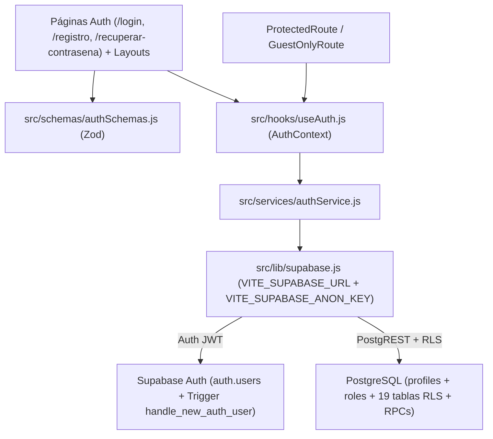

# ETAPA 3 — AUDITORÍA TÉCNICA DE SEGURIDAD Y AUTENTICACIÓN
## Proyecto: FORJA BRAVA — SIGR

**Fecha de auditoría:** 2026-11-24  
**Alcance:** Diagnóstico de solo lectura previo a la implementación de la Etapa 3 (Seguridad, Autenticación y Autorización en frontend React + integración con Supabase Auth, RLS y RPCs).  
**Restricciones cumplidas:** No se implementaron funcionalidades, no se alteró la base de datos ni las migraciones aplicadas, no se modificaron archivos de configuración y no se expusieron valores de `.env`.

---

## 1. Estado actual del proyecto

El repositorio combina dos planos claramente diferenciados:

1. **Capa Backend / Base de Datos (Supabase PostgreSQL 17):** Las 6 migraciones SQL locales (`supabase/migrations/20261123221001` a `20261123221006`) ya contemplan las 19 tablas con **RLS habilitado**, triggers de creación automática de perfil y anti-escalamiento de roles, bucket `product-images` y 16 funciones RPC/internas `SECURITY DEFINER` con `REVOKE ALL` explícito y `SET search_path = public, pg_temp`. Según el contexto del proyecto, estas migraciones ya fueron aplicadas al proyecto remoto; su verificación funcional en vivo (ejecución de la suite SQL y pruebas desde el cliente React) permanece pendiente.
2. **Capa Frontend (React 19 + Vite + Tailwind CSS v4 + React Router + Zod):** Se completó la Etapa 1 (base ejecutable, landing pública, rutas temporales `/cliente/*`, `/mesero/*`, `/admin/*` y `404`). **Todavía no está instalado `@supabase/supabase-js` ni existe el cliente Supabase, contexto de autenticación, formularios de acceso/registro/recuperación ni guardias de rutas.**

### Resumen de las 10 verificaciones obligatorias

| # | Verificación obligatoria | Estado | Evidencia en el repositorio |
|---|---|---|---|
| 1 | Cliente Supabase configurado | **NO IMPLEMENTADO** | `@supabase/supabase-js` ausente en `package.json`; no existe `src/lib/supabase.js` ni `src/services/supabaseClient.js`. `src/services/serviceConfig.js` reporta `backendConnected: false`. |
| 2 | Contexto global de autenticación | **NO IMPLEMENTADO** | No existe `src/context/` ni `AuthContext` en `src/app/App.jsx`. |
| 3 | Persistencia y recuperación de sesión | **NO IMPLEMENTADO** | No hay suscripción a `supabase.auth.onAuthStateChange` ni lectura de `getSession()`. |
| 4 | Registro e inicio de sesión | **NO IMPLEMENTADO** (en React) / **REQUIERE CORRECCIÓN** (en legacy) | No existen páginas `/login` ni `/registro` en `src/routes/AppRouter.jsx`. Persisten archivos legacy (`admin.html`, `js/admin.js`, `js/app.js`) con auth local insegura. |
| 5 | Recuperación de contraseña | **NO IMPLEMENTADO** | No existe ruta `/recuperar-contrasena` ni flujo `resetPasswordForEmail` / `updateUser`. |
| 6 | Asignación de roles a usuarios | **IMPLEMENTADO, PENDIENTE DE VERIFICACIÓN** | Trigger `on_auth_user_created` (`handle_new_auth_user()`) en migración `01` asigna siempre rol fijo `cliente`; `protect_profile_privileged_fields()` impide auto-escalamiento y protege al último `administrador`. |
| 7 | Consulta de permisos | **IMPLEMENTADO, PENDIENTE DE VERIFICACIÓN** *(con ajuste de diseño para UI)* | Tablas `roles`, `permissions`, `role_permissions` creadas y pobladas (migraciones `01` y `06`). En migración `04`, `permissions` y `role_permissions` son `SELECT` exclusivo de `is_admin()`, por lo que `cliente` y `mesero` consultan su rol vía `profiles` + `roles` (o mediante una futura RPC de solo lectura). |
| 8 | Protección de rutas | **NO IMPLEMENTADO** | `src/routes/AppRouter.jsx` expone `/cliente/*`, `/mesero/*` y `/admin/*` sin `ProtectedRoute` ni `GuestOnlyRoute`. |
| 9 | Políticas RLS protegiendo datos | **IMPLEMENTADO, PENDIENTE DE VERIFICACIÓN** | Las 19 tablas tienen `ENABLE ROW LEVEL SECURITY` y políticas granulares en migración `04`. Falta ejecutar la suite de pruebas RLS contra el proyecto remoto. |
| 10 | Protección de funciones RPC | **IMPLEMENTADO, PENDIENTE DE VERIFICACIÓN** | 24 sentencias `REVOKE ALL ON FUNCTION ... FROM PUBLIC, anon, authenticated` y `GRANT EXECUTE` mínimo en migraciones `01`, `03` y `05`, más validación interna de rol (`is_admin()`, `is_waiter()`, `auth.uid()`). Falta verificación en vivo. |

---

## 2. Archivos y componentes existentes

| Ubicación | Descripción | Estado |
|---|---|---|
| `package.json` | React `^19.3.1`, React Router `^7.18.6`, Zod `^4.6.7`, Vite `^8.3.8`, Tailwind v4, ESLint. **Falta `@supabase/supabase-js`.** | **REQUIERE CORRECCIÓN** (añadir `@supabase/supabase-js`) |
| `.env` y `.env.example` | `.env` existe (excluido en `.gitignore`) y define únicamente las variables esperadas `VITE_SUPABASE_URL` y `VITE_SUPABASE_ANON_KEY` (sin `SERVICE_ROLE`). | **IMPLEMENTADO Y VERIFICADO** (presencia de nombres seguros) |
| `src/lib/env.js` | Valida variables `VITE_*` con Zod y expone `isSupabaseConfigured`. No valida formato `.url()` cuando `VITE_SUPABASE_URL` está informada. | **REQUIERE CORRECCIÓN** (endurecer validación URL) |
| `src/services/serviceConfig.js` | Placeholder de Etapa 1 (`backendConnected: false`). | **NO IMPLEMENTADO** (sin cliente ni servicios reales) |
| `src/routes/AppRouter.jsx` | Rutas `/`, `/cliente/*`, `/mesero/*`, `/admin/*`, `*` sin guardias ni rutas `/login`, `/registro`, `/recuperar-contrasena`, `/acceso-denegado`. | **NO IMPLEMENTADO** (protección y rutas auth) |
| `src/app/App.jsx` | Envuelve `AppRouter` en `BrowserRouter`, sin `AuthProvider`. | **NO IMPLEMENTADO** (`AuthProvider`) |
| `src/pages/*PlaceholderPage.jsx` | Páginas informativas de Etapa 1 para Cliente, Mesero y Admin. | **IMPLEMENTADO Y VERIFICADO** (como placeholders de Etapa 1) |
| `supabase/migrations/20261123221001..06` | Esquema completo de 19 tablas, RLS, triggers, Storage, Realtime, 16 funciones y semilla idempotente. | **IMPLEMENTADO, PENDIENTE DE VERIFICACIÓN** (en remoto) |
| `admin.html`, `js/admin.js`, `js/app.js` | Archivos legacy del prototipo estático con credenciales hardcoded (`Admin123*`) y auth en `localStorage`/`sessionStorage`. | **REQUIERE CORRECCIÓN** (retirar o aislar antes de despliegue productivo) |
| `supabase/migrations.zip`, `supabase/migrations (2).zip` | Archivos comprimidos temporales detectados dentro de `supabase/`. | **REQUIERE CORRECCIÓN** (limpieza operativa futura, no tocar migraciones) |

---

## 3. Estructura de autenticación encontrada

- **En Frontend React (`src/`):** **NO IMPLEMENTADO.** No existen servicios de autenticación (`signUp`, `signInWithPassword`, `signOut`, `resetPasswordForEmail`, `updateUser`), ni contexto de sesión, ni vistas de Login/Registro/Recuperación.
- **En Supabase PostgreSQL (`supabase/migrations/20261123221001`):** **IMPLEMENTADO, PENDIENTE DE VERIFICACIÓN.**
  - Trigger `on_auth_user_created` (`AFTER INSERT ON auth.users`) ejecuta `public.handle_new_auth_user()` (`SECURITY DEFINER`) creando automáticamente la fila en `public.profiles` con `role_id` fijo a `'cliente'` e `is_active = true`, tomando `full_name` y `phone` desde `raw_user_meta_data` (con saneamiento de longitud mínima).
  - Trigger `trg_protect_profile_privileged_fields` (`BEFORE UPDATE OR DELETE ON public.profiles`) impide que cualquier usuario no administrador modifique `id`, `role_id`, `is_active` o `email`, y bloquea desactivar, degradar o eliminar al último administrador activo (`LAST_ADMIN_PROTECTED`).

---

## 4. Estado de roles y permisos

- **Roles oficiales (`public.roles`):** `cliente`, `mesero`, `administrador` (**IMPLEMENTADO, PENDIENTE DE VERIFICACIÓN**).
- **Permisos declarativos (`public.permissions` y `public.role_permissions`):** 18 permisos definidos y asignados en migración `06` (**IMPLEMENTADO, PENDIENTE DE VERIFICACIÓN**).
- **Funciones auxiliares de rol (migración `01`):**
  - `public.current_user_role()`: consulta `profiles JOIN roles` filtrando `p.id = auth.uid() AND p.is_active = true`. Si un usuario es desactivado (`is_active = false`), retorna `NULL`, bloqueando inmediatamente RLS y RPCs.
  - `public.is_admin()` y `public.is_waiter()`: evalúan `current_user_role()` de forma `STABLE SECURITY DEFINER`.
- **Observación clave sobre consulta de permisos desde React:**
  - Las tablas `permissions` y `role_permissions` tienen RLS `SELECT` exclusivo para `public.is_admin()`. Esto es seguro, pero implica que un usuario `cliente` o `mesero` **no puede consultar directamente `role_permissions` vía PostgREST**.
  - **Recomendación:** El `AuthContext` obtendrá el perfil y rol real haciendo `SELECT id, full_name, email, phone, is_active, roles(code, name) FROM profiles WHERE id = auth.uid()` (permitido por `profiles_select_own_or_admin` + `roles_select_authenticated`). Si se desea consultar permisos granulares desde la UI para cualquier rol, crear posteriormente una nueva migración aditiva con una función `get_my_permissions()` de solo lectura (nunca abrir `role_permissions` con políticas permisivas ni editar migraciones ya aplicadas).

---

## 5. Estado de las políticas RLS

**Estado global:** **IMPLEMENTADO, PENDIENTE DE VERIFICACIÓN** (19/19 tablas con `ENABLE ROW LEVEL SECURITY` en `20261123221004_rls_policies_and_storage.sql`).

- **Aislamiento de clientes:** `profiles`, `customer_addresses`, `orders`, `order_items`, `order_status_history`, `payments` y `reservations` filtran estrictamente por `auth.uid()` (ningún cliente puede leer ni modificar datos privados de otro cliente).
- **Aislamiento de mesero:** Solo lee `restaurant_tables`, `reservations`, `table_accounts` y `orders`/`order_items`/`order_status_history` con `modality = 'mesa'`. **Cero acceso** a `payments`, `cash_sessions`, `cash_movements`, `audit_logs`, `permissions` ni pedidos de `domicilio`/`recoger`.
- **Escritura controlada:** Ninguna tabla crítica (`orders`, `order_items`, `payments`, `table_accounts`, `cash_sessions`, `cash_movements`, `audit_logs`, `order_status_history`) permite `INSERT/UPDATE/DELETE` directo por clientes ni meseros; las mutaciones operativas pasan exclusivamente por RPCs validadas, y `audit_logs`, `order_status_history` y `cash_movements` tienen además triggers de inmutabilidad (`prevent_immutable_table_mutation`).
- **Storage (`product-images`):** Lectura pública, escritura/eliminación exclusiva de `is_admin()`, límite `2 MB` y MIME types restringidos (`webp`, `png`, `jpeg`).

---

## 6. Estado de las funciones RPC

**Estado global:** **IMPLEMENTADO, PENDIENTE DE VERIFICACIÓN** (`20261123221005_business_rpcs_and_integrity.sql`).

- **Blindaje `SECURITY DEFINER`:** Todas las funciones (24 en total entre triggers, internas, helpers y RPCs) ejecutan `REVOKE ALL ON FUNCTION ... FROM PUBLIC, anon, authenticated` y fijan `SET search_path = public, pg_temp`.
- **Funciones internas inaccesibles vía API:** `log_audit_event`, `recalculate_table_account_total`, `sync_table_status` y las 5 funciones trigger **no tienen `GRANT EXECUTE`** para `anon` ni `authenticated`.
- **RPCs expuestas:**
  - `anon, authenticated`: únicamente `get_available_reservation_slots` (solo lectura de cupos).
  - `authenticated` con validación estricta interna: `create_reservation`, `cancel_reservation`, `create_order` (anti-suplantación, `product_complements`, precios en servidor, `allow_client_table_orders = false`), `create_table_order` (`mesero`/`admin`), `update_order_status` (matriz D-05), `request_table_account_close` (`mesero`/`admin`), y exclusivas de `administrador`: `open_cash_session`, `register_cash_movement`, `confirm_order_payment`, `refund_order_payment` (con validación `INSUFFICIENT_CASH_FOR_REFUND`), `settle_table_account` y `close_cash_session`.

---

## 7. Vulnerabilidades y riesgos identificados

| ID | Severidad | Hallazgo | Clasificación | Mitigación recomendada |
|---|---|---|---|---|
| **AUT-01** | **Alto** | Rutas `/cliente/*`, `/mesero/*` y `/admin/*` en `AppRouter.jsx` son accesibles sin sesión ni validación de rol. | **NO IMPLEMENTADO** | Implementar `AuthContext`, `ProtectedRoute` (con verificación de `is_active` y `role`) y `GuestOnlyRoute` en Etapa 3. |
| **AUT-02** | **Alto** | Archivos legacy `admin.html` y `js/admin.js` en la raíz del proyecto conservan credenciales hardcodeadas (`admin@forjabrava.com` / `Admin123*`). | **REQUIERE CORRECCIÓN** | Asegurar que el despliegue (Vercel) publique únicamente `dist/` generado por Vite y planificar el retiro controlado de `admin.html`/`js/` cuando se migre el panel admin. |
| **AUT-03** | **Medio** | `src/lib/env.js` usa `VITE_SUPABASE_ANON_KEY` pero no valida formato URL estricto cuando está presente ni advierte si falta configuración en tiempo de ejecución de Auth. | **REQUIERE CORRECCIÓN** | Validar URL con Zod (`z.string().url()`) y mostrar error controlado si falta configurar Supabase, sin exponer claves ni caer silenciosamente. |
| **AUT-04** | **Medio** | Ausencia de manejo en frontend para usuarios desactivados (`profiles.is_active = false`): si un admin desactiva a un usuario con sesión abierta, `current_user_role()` devuelve `NULL` en BD, pero el cliente necesita detectar `is_active === false`, cerrar sesión y mostrar aviso claro. | **NO IMPLEMENTADO** | Validar `profile.is_active` en `AuthContext` al iniciar sesión y al hidratar sesión, ejecutando `signOut()` inmediato si está inactivo. |
| **AUT-05** | **Medio** | Las migraciones aplicadas en el proyecto remoto aún no han sido verificadas con pruebas reales de ejecución de RLS y RPCs por rol. | **IMPLEMENTADO, PENDIENTE DE VERIFICACIÓN** | Ejecutar la suite transaccional (`BEGIN ... ROLLBACK`) de `docs/04-base-datos/auditoria-migraciones-sql.md` en Supabase y pruebas de integración en Etapa 3. |
| **AUT-06** | **Bajo** | Existen dos archivos ZIP temporales (`supabase/migrations.zip` y `supabase/migrations (2).zip`) dentro de `supabase/`. | **REQUIERE CORRECCIÓN** | Retirar archivos temporales antes de consolidar commits (fuera de esta auditoría). |

---

## 8. Componentes pendientes de implementar (Etapa 3)

1. **Dependencia oficial:** Instalar `@supabase/supabase-js`.
2. **Cliente Supabase (`src/lib/supabase.js`):** Instancia única con `VITE_SUPABASE_URL` y `VITE_SUPABASE_ANON_KEY` (clave pública publishable/anon), `persistSession: true`, `autoRefreshToken: true`, `detectSessionInUrl: true`.
3. **Esquemas Zod (`src/schemas/authSchemas.js`):** Validación estricta de login, registro (nombre, correo, teléfono, contraseña `>= 8` + confirmación), solicitud de recuperación y nueva contraseña.
4. **Servicio de autenticación (`src/services/authService.js`):** Encapsulación de `signUp`, `signInWithPassword`, `signOut`, `resetPasswordForEmail`, `updatePassword`, `getSession` y `fetchUserProfile` (`profiles` + `roles`).
5. **Contexto global (`src/context/AuthContext.jsx` y `src/hooks/useAuth.js`):** Hidratación inicial, listener `onAuthStateChange`, detección de cuenta inactiva (`is_active === false`), recarga de perfil y helpers (`role`, `isAdmin`, `isWaiter`, `isClient`).
6. **Guardias de rutas (`src/routes/ProtectedRoute.jsx` y `src/routes/GuestOnlyRoute.jsx`):**
   - `ProtectedRoute`: espera fin de hidratación (`loading`), redirige a `/login?redirect=...` si no hay sesión, valida `allowedRoles` y redirige a `/acceso-denegado` (`403`) si el rol no corresponde.
   - `GuestOnlyRoute`: redirige al dashboard según rol (`/cliente`, `/mesero`, `/admin`) o a `?redirect=` si ya está autenticado.
7. **Páginas de autenticación y acceso (`src/pages/auth/`):**
   - `LoginPage.jsx` (`/login`)
   - `RegisterPage.jsx` (`/registro`)
   - `ForgotPasswordPage.jsx` (`/recuperar-contrasena`)
   - `ResetPasswordPage.jsx` (`/actualizar-contrasena` — destino del enlace de recuperación de Supabase Auth)
   - `UnauthorizedPage.jsx` (`/acceso-denegado`)
8. **Integración en Layouts (`PublicLayout`, `AreaPlaceholderLayout`):** Mostrar estado real de sesión en el header (`INICIAR SESIÓN` vs `MI CUENTA · Nombre` + `CERRAR SESIÓN`) y ocultar enlaces de áreas no autorizadas sin sustituir el control de servidor.

---

## 9. Propuesta de arquitectura (Etapa 3)

- **Principio de confianza cero en cliente:** React decide qué mostrar y a qué ruta redirigir consultando `profiles` + `roles` autenticados por JWT; PostgreSQL (RLS + triggers + RPCs) es la única autoridad real de permisos.
- **Identidad visual conservada:** Todas las vistas de autenticación reutilizan `.login-screen`, `.auth-card`, `.button-fire`, paleta oficial (`#171613`, `#f1e8d8`, `#e9dfcf`, `#c66a32`, `#e07c42`) y tipografías `Playfair Display` + `DM Sans`.

---

## 10. Plan de implementación por fases (Etapa 3)

1. **Fase 3.1 — Base Supabase y validación de entorno:** Instalar `@supabase/supabase-js`, endurecer `src/lib/env.js` y crear `src/lib/supabase.js` + `src/services/authService.js`.
2. **Fase 3.2 — Estado global y persistencia de sesión:** Implementar `AuthContext.jsx` y `useAuth.js` con hidratación de sesión, `onAuthStateChange`, lectura de `profiles` + `roles` y cierre automático si `is_active === false`.
3. **Fase 3.3 — Pantallas de autenticación con Zod e identidad FORJA BRAVA:** Crear `authSchemas.js`, `LoginPage`, `RegisterPage`, `ForgotPasswordPage`, `ResetPasswordPage` y `UnauthorizedPage`.
4. **Fase 3.4 — Protección de rutas y navegación consciente de rol:** Implementar `ProtectedRoute`, `GuestOnlyRoute`, actualizar `AppRouter.jsx`, `App.jsx`, `PublicLayout.jsx` y `AreaPlaceholderLayout.jsx` con cierre de sesión y redirecciones por rol.
5. **Fase 3.5 — Verificación técnica integral:** Ejecutar `npm run lint`, `npm run build` y validar en vivo los flujos reales contra Supabase Auth (registro de `cliente`, login, persistencia tras recarga, recuperación de contraseña, bloqueo `403` entre roles, y verificación de RLS en PostgreSQL).
