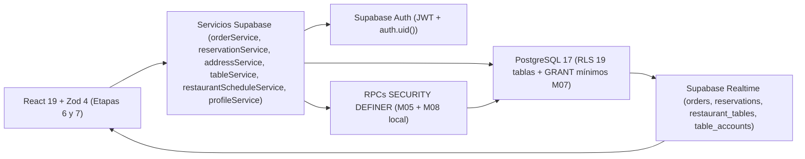

# Auditoría Técnica Integral — Etapas 6 y 7
## FORJA BRAVA — SIGR (Sistema Integral de Gestión de Restaurante)

**Fecha de auditoría:** 24 de noviembre de 2026 (`America/Bogota`)  
**Modalidad:** Auditoría técnica de solo lectura (sin modificaciones de código, migraciones, políticas ni datos remotos)  
**Repositorio local inspeccionado:** `C:\Users\Sebastian\Documents\Urestaurante`  
**Alcance SQL:** Migraciones `01` a `07` (aplicadas previamente en remoto) + Migración `08` local (NO aplicada en remoto)  

---

## 1. Resumen ejecutivo

Se ejecutó una auditoría técnica integral sobre el código SQL (`supabase/migrations/20261123221001` a `20261124230008`), las políticas RLS y permisos `GRANT`/`REVOKE`, las funciones RPC transaccionales, los servicios y páginas React de las **Etapas 6 y 7**, la configuración comercial (`restaurant_settings`) y la batería de pruebas locales (`eslint`, `vitest`, `vite build`, `playwright`).

La arquitectura base de seguridad y persistencia es **sólida**:
- Las 19 tablas públicas tienen **RLS habilitado** (`04`) y **privilegios mínimos `GRANT`** (`07`).
- Los precios de productos, complementos y tarifa de domicilio se calculan **exclusivamente en PostgreSQL** (`public.create_order`), sin confiar en valores del navegador.
- Los pagos simulados nunca solicitan ni almacenan datos bancarios reales y están restringidos por `CHECK (is_simulated = true)`.
- La prevención de solapamiento de reservas está respaldada por la restricción atómica **GiST `excl_reservations_no_overlap`** y `FOR UPDATE SKIP LOCKED` en `create_reservation`.
- La regla **D-04** (cuenta única acumulada por mesa) está respaldada por el índice único parcial `idx_table_accounts_one_active_per_table` y bloqueo `FOR UPDATE` sobre `restaurant_tables`.

Sin embargo, la inspección línea por línea identificó **hallazgos reales de severidad ALTA y MEDIA** que impiden aprobar ciegamente el pase inmediato a despliegue remoto sin correcciones previas:
1. **[ALTO]** Desbordamiento de medianoche (`::time`) en `public.create_reservation` (`05` L323) que permite eludir la validación `OUT_OF_HOURS` al invocar la RPC cerca de la medianoche.
2. **[ALTO]** La idempotencia por `client_request_id` en `public.create_order` (`05` L548–560) impide pedidos duplicados mediante `UNIQUE`, pero **no rechaza** reenvíos con la misma clave y payload diferente, y ante concurrencia exacta retorna error `23505` en lugar de devolver el pedido existente.
3. **[ALTO]** La **Migración 08** (`admin_manage_reservation` y `set_default_customer_address`) presenta brechas en transiciones de estado (`Cancelada` → `Atendida` sin chequeo de solapamiento, `cancelled_at` sin limpiar), riesgo de *deadlock* por orden de bloqueos y ausencia de validación `is_active = true` en `set_default_customer_address`.
4. **[MEDIO]** Fallbacks frontend no transaccionales en `addressService.js` y `reservationService.js` (este último omite capacidad, `sync_table_status` y `audit_logs` mientras la Migración 08 no se despliegue).
5. **[MEDIO]** Defectos funcionales concretos: reactivación de mesa desde modal de edición en `tableService.js` (L104–114) no restaura `status = 'disponible'`; ausencia de protección al reducir capacidad o desactivar mesas con reservas futuras confirmadas; desfase horario UTC en el filtro de fecha de `ClientHistoryPage.jsx` (L45); y posible divergencia de precios entre Pase 1 y Pase 2 en `create_order` bajo concurrencia de edición de catálogo.
6. **[LIMITACIÓN]** Las pruebas locales (`56/56` Vitest y `18/18` Playwright) pasan al 100%, pero operan con mocks e interceptores HTTP; **no constituyen verificación en vivo de RLS ni de concurrencia real en PostgreSQL remoto**.

**Dictamen global:** `REQUIERE CORRECCIONES ANTES DE VALIDAR`

---

## 2. Alcance

- **Base de datos y migraciones:** `supabase/migrations/20261123221001` a `20261123221006`, `20261124210007_least_privilege_table_grants.sql` y `20261124230008_admin_reservations_and_schedule_rpcs.sql`.
- **Tablas auditadas:** `profiles`, `roles`, `permissions`, `role_permissions`, `customer_addresses`, `products`, `product_complements`, `restaurant_settings`, `restaurant_tables`, `reservations`, `table_accounts`, `orders`, `order_items`, `order_status_history`, `payments`, `cash_sessions`, `cash_movements`, `audit_logs`.
- **Servicios frontend:** `profileService.js`, `addressService.js`, `orderService.js`, `orderTrackingService.js`, `reservationService.js`, `tableService.js`, `restaurantScheduleService.js`.
- **Páginas, esquemas y utilidades:** `ClientProfilePage.jsx`, `ClientAddressesPage.jsx`, `CheckoutPage.jsx`, `ClientOrdersPage.jsx`, `ClientOrderDetailPage.jsx`, `ClientTrackingPage.jsx`, `ClientHistoryPage.jsx`, `ClientReservationsPage.jsx`, `AdminTablesPage.jsx`, `AdminReservationsPage.jsx`, `AdminScheduleConfigPage.jsx`, `clientSchemas.js`, `adminSchemas.js`, `formatDate.js`, `AppRouter.jsx`.
- **Calidad y pruebas:** `npm run lint`, `npm test`, `npm run build`, `npm run test:e2e`.

---

## 3. Metodología

1. **Inspección estática de SQL y trazabilidad extremo a extremo:** lectura completa de las 8 migraciones SQL, cotejando restricciones (`CHECK`, `UNIQUE`, `EXCLUDE USING gist`), triggers, `GRANT`/`REVOKE`, políticas RLS y cuerpos PL/pgSQL.
2. **Contraste frontend ↔ backend:** seguimiento de cada flujo desde el formulario React y esquema Zod hasta el servicio Supabase y el RPC/tabla PostgreSQL correspondiente.
3. **Verificación local no destructiva:** ejecución limpia de `eslint`, `vitest`, `vite build` y `playwright test` sin modificar código ni pruebas.
4. **Limitación explícita:** por restricción obligatoria de la auditoría, no se ejecutaron escrituras, pruebas de concurrencia ni migraciones contra el proyecto Supabase remoto.

---

## 4. Arquitectura inspeccionada



**Nota estructural sobre complementos:** El esquema real (`03` L204–218) **no** utiliza una tabla separada `order_item_complements`; almacena el snapshot inmutable de complementos en `public.order_items.addons_snapshot` (`jsonb`) y su monto acumulado en `addons_total` (`numeric(12,2)`), validado por `CHECK (line_total = (unit_price_snapshot * quantity) + addons_total)`.

---

## 5. Auditoría de pedidos (`public.create_order`)

Archivo inspeccionado: `supabase/migrations/20261123221005_business_rpcs_and_integrity.sql` (L476–979) y `20261123221003_tables_reservations_orders_cash_audit_schema.sql` (L112–245).

### 5.1 Integridad transaccional

Todas las operaciones de `public.create_order` se ejecutan dentro de una **única función PL/pgSQL** (y por tanto en una sola transacción atómica en PostgreSQL):

1. Validación de usuario activo (`auth.uid()`, `current_user_role()`, `profiles.is_active = true`) — L529–545.
2. Verificación de idempotencia `p_client_request_id` — L548–560.
3. Validación de modalidad, rol, dirección/reserva/mesa y apertura o reutilización de `table_accounts` — L563–726.
4. Validación de carrito, método de pago y existencia de sesión de caja abierta para pagos digitales — L729–754.
5. Pase 1: validación de cantidades (`>= 1`), productos disponibles, complementos válidos en `product_complements` sin duplicados y cálculo de `v_subtotal` y `v_total` — L757–812.
6. Inserción en `orders` — L815–864.
7. Pase 2: inserción de snapshots inmutables en `order_items` — L867–916.
8. Inserción de historial inicial en `order_status_history` — L919–920.
9. Inserción en `payments` (y en `cash_movements` si es pago digital confirmado) o recálculo de `table_accounts` + `sync_table_status` si es `mesa` — L923–969.
10. Registro en `audit_logs` — L971.

**Respuestas explícitas:**
- **¿Qué sucede si falla la inserción de un detalle (`order_items`)?** PostgreSQL aborta y hace `ROLLBACK` completo de `orders`, `table_accounts` (si fue creada), `reservations` (si pasó a `Atendida`), etc.
- **¿Qué sucede si falla el registro del pago (`payments` o `cash_movements`)?** `ROLLBACK` completo; no persiste ni el pedido ni sus líneas ni su historial.
- **¿Puede quedar un pedido parcialmente creado?** **No**, salvo el riesgo de divergencia de importes entre Pase 1 y Pase 2 descrito abajo.
- **¿Puede existir un pedido sin historial inicial?** **No** vía `create_order` (L919–920 inserta obligatoriamente `'Pendiente'`), y `authenticated` no tiene `GRANT INSERT` directo sobre `orders` (`07` L66–75).
- **¿Puede existir un pedido con total incorrecto?** En `orders`, `chk_orders_total_sum` garantiza `total = subtotal + delivery_fee`, y en `order_items`, `chk_order_items_line_math` garantiza `line_total = (unit_price_snapshot * quantity) + addons_total`. **Hallazgo `AUD-04` (MEDIO):** entre el Pase 1 (L764, L791) y el Pase 2 (L870, L879) no se bloquean las filas de `products` (`FOR SHARE`) ni se reutilizan los precios cacheados del Pase 1; si un administrador modifica el precio de un producto exactamente entre ambos bucles en aislamiento `READ COMMITTED`, `orders.subtotal` y `SUM(order_items.line_total)` podrían divergir.
- **¿Puede quedar una cuenta de mesa sin pedido asociado?** Si falla la creación del pedido, la inserción de `table_accounts` (L704) se revierte por `ROLLBACK`. Sí puede quedar una `table_account` con `total_amount = 0` si posteriormente todos sus pedidos pasan a `Cancelado` vía `update_order_status` (L1087–1089); en ese caso `settle_table_account` (L1640) permite cerrarla con `$0` sin generar pago.

### 5.2 Validación de precios

- `buildOrderRpcPayload` (`src/services/orderService.js` L29–60) envía únicamente `product_id`, `quantity` y `addon_ids`. **No envía precios, subtotales, totales ni tarifa de domicilio.**
- `public.create_order` (`05` L591, L764–811) lee `products.price` (base y complementos) y `restaurant_settings.fixed_delivery_fee` directamente desde PostgreSQL.
- **Conclusión:** No existe manipulación posible de precios desde React ni mediante invocación directa a la API RPC.

---

## 6. Auditoría de idempotencia (`client_request_id`)

Archivos inspeccionados: `03` L115, `05` L548–560, `CheckoutPage.jsx` L100, L190–209.

- **Restricción `UNIQUE` efectiva:** Sí (`orders.client_request_id uuid UNIQUE`, `03` L115). Impide la creación de dos pedidos con el mismo UUID a nivel de motor PostgreSQL.
- **Vinculación al usuario:** Al encontrar `v_existing`, `create_order` (L554) verifica `v_existing.customer_id = v_actor OR v_existing.waiter_id = v_actor OR v_role = 'administrador'`; de lo contrario lanza `DUPLICATE_REQUEST_ID`. Esto previene fuga de pedidos ajenos por colisión/adivinación de UUID.
- **Solicitud repetida secuencial:** Devuelve `v_existing` sin duplicar pedido ni cobro.
- **Hallazgo `AUD-02` (ALTO) — Ausencia de validación de contenido en reintento:** Si un cliente reenvía el mismo `p_client_request_id` con `p_items`, `p_modality` o `p_payment_method` distintos, `create_order` (L555) devuelve silenciosamente `v_existing` sin rechazar la discrepancia de payload.
- **Hallazgo `AUD-03` (MEDIO) — Ventana de carrera en solicitudes estrictamente simultáneas:** Dos solicitudes paralelas con el mismo `p_client_request_id` pueden ambas superar el `SELECT` inicial (L549) antes de que cualquiera haga `INSERT` (L815); la restricción `UNIQUE` **evita el duplicado** (no se crean dos pedidos), pero la segunda solicitud recibe un error `23505 unique_violation` no capturado por `mapOrderRpcError` en lugar de recibir `v_existing` de forma idempotente.
- **Nota sobre `NULL`:** `p_client_request_id` tiene `DEFAULT NULL`; si un invocador directo omite la clave, `UNIQUE` permite múltiples `NULL`. Desde `CheckoutPage.jsx` siempre se genera un UUID estable (`requestIdRef`).

---

## 7. Auditoría de pagos simulados (`public.payments`)

Archivos inspeccionados: `03` L247–283, `05` L733–754, L923–965, L1234–1543, `CheckoutPage.jsx` L45–66, L510–575.

- **Presentación exclusiva como demostración:** Verificado tanto en UI (`CheckoutPage.jsx` L45–66: etiquetas explícitas *"simulación controlada"*, sin inputs de tarjeta/CVV/banco) como en PostgreSQL (`is_simulated boolean NOT NULL DEFAULT true CHECK (is_simulated = true)` y `disclaimer` obligatorio en `03` L257–258).
- **Asociación y exclusividad:** `chk_payments_exclusive_target` (`03` L262–263) garantiza que un pago pertenezca exclusivamente a un `order_id` **o** a un `table_account_id`, nunca a ambos ni a ninguno.
- **Protección contra pagos duplicados:**
  - `idx_payments_one_confirmed_per_order` (`03` L266–268)
  - `idx_payments_one_confirmed_per_table_account` (`03` L270–272)
  - `idx_payments_one_pending_per_order` (`03` L274–276)
  - `idx_cash_movements_one_sale_per_payment` y `idx_cash_movements_one_refund_per_payment` (`03` L333–339)
- **Coherencia pago ↔ pedido y manejo de estados:**
  - `Efectivo`: crea pago `Pendiente` y pedido con `payment_status = 'Pendiente'` (no marca pagado ni asienta caja hasta `confirm_order_payment` por administrador).
  - `Tarjeta`/`Nequi`/`PSE` (simulación aprobada): exige sesión de caja abierta (`FOR KEY SHARE`), marca `Confirmación simulada`, fija `paid_at = now()`, referencia `DEMO-...` y registra `cash_movements(movement_type = 'sale')` atómicamente.
  - Simulación rechazada (`p_simulate_payment_failure = true`): lanza `PAYMENT_SIMULATION_FAILED` (`05` L735–736) y revierte toda la transacción (no crea pedido impago ni pago fantasma).
  - Reembolsos (`refund_order_payment`, `05` L1371–1538): exclusivo administrador, exige pedido `Cancelado`, verifica liquidez física (`INSUFFICIENT_CASH_FOR_REFUND`) solo para `Efectivo`, registra movimiento `refund` en `cash_movements` y evita duplicación.
  - Pedidos en mesa (`modality = 'mesa'`): nunca crean fila en `payments` ni cierran `table_accounts`; quedan `payment_status = 'Pendiente'` hasta `settle_table_account`.
- **Observación operativa (`AUD-11`, BAJO):** Si el administrador no ha abierto turno de caja (`cash_sessions.status = 'open'`), cualquier cliente que intente pagar online con `Tarjeta`/`Nequi`/`PSE` recibirá `CASH_CLOSED` (`orderService.js` L5 lo comunica claramente y sugiere `Efectivo`).

---

## 8. Auditoría de cuentas de mesa — D-04

Archivos inspeccionados: `03` L89–110, L165–176, `05` L53–74, L672–726, L966–969, L1087–1089, L1546–1713.

1. **Creación de cuenta:** Exclusivamente dentro de `create_order` (`05` L696–706) cuando `p_modality = 'mesa'` y no existe cuenta activa para esa mesa.
2. **Identificación de cuenta activa:** `status IN ('open', 'closing_requested')`.
3. **Asociación de pedidos e incorporación de pedidos posteriores:** `create_order` consulta la cuenta activa existente con `FOR UPDATE` (L696–701), asocia `orders.table_account_id = v_account_id` y ejecuta `recalculate_table_account_total(v_account_id)` (L967).
4. **Prevención de cuentas duplicadas y concurrencia simultánea:**
   - Doble mecanismo en BD: bloqueo de fila `SELECT * FROM restaurant_tables WHERE id = v_effective_table_id FOR UPDATE` (`05` L672–677) que serializa pedidos simultáneos para la misma mesa + índice único parcial `idx_table_accounts_one_active_per_table ON table_accounts (table_id) WHERE status IN ('open', 'closing_requested')` (`03` L104–106).
5. **Cálculo de saldo acumulado:** `recalculate_table_account_total` (`05` L53–74) suma `orders.total` donde `status <> 'Cancelado'`.
6. **Cancelación de pedido en mesa:** `update_order_status` (`05` L1087–1089) recalcula automáticamente `table_accounts.total_amount`.
7. **Cierre y cobro:** `request_table_account_close` (mesero/admin) pasa a `closing_requested`; `settle_table_account` (exclusivo admin, exige caja abierta y cero comandas sin entregar/cancelar) inserta un único `payments(table_account_id)` + `cash_movements`, marca los pedidos no cancelados como `Confirmación simulada`, cierra la cuenta (`closed`) y llama a `sync_table_status`.
8. **Relación con reservas futuras:** `create_reservation` (`05` L254–390) **nunca** inserta en `table_accounts`; solo actualiza `restaurant_tables.status = 'reservada'` si la reserva es inminente (`sync_table_status` L132–142).
9. **Observación (`AUD-10`, MEDIO):** `create_order` (L699) permite agregar nuevos pedidos incluso cuando la cuenta ya está en `status = 'closing_requested'`. Aunque recalcula el total correctamente y `settle_table_account` bloquearía el cobro si el nuevo pedido no está entregado (`PENDING_ORDERS_IN_ACCOUNT`), conviene definir si `closing_requested` debe rechazar nuevas comandas o reabrir explícitamente a `open`.

**Dictamen específico D-04:** **CUMPLIDO** en el motor transaccional de PostgreSQL (con observación menor `AUD-10` sobre `closing_requested`).

---

## 9. Auditoría de reservas y disponibilidad

Archivos inspeccionados: `03` L21–86, `05` L81–464, `08` L64–164, `reservationService.js`, `ClientReservationsPage.jsx`, `AdminReservationsPage.jsx`, `formatDate.js`.

### 9.1 Disponibilidad (`get_available_reservation_slots` y `create_reservation`)
- Verifica mesas activas (`is_active = true`, `status <> 'fuera_de_servicio'`), capacidad (`capacity >= p_party_size`), zona opcional, fecha no pasada (`v_today_bogota`), horario semanal (`business_hours -> day_key`, `closed`), duración configurada (`reservation_duration_minutes`) y ausencia de solapamientos contra estados bloqueantes (`Pendiente`, `Confirmada`).
- **Excepciones de calendario (festivos/cierres puntuales):** No existe tabla de excepciones de calendario; el modelo gestiona únicamente horario semanal por día de la semana (`monday`..`sunday`).
- **Hallazgo `AUD-01` (ALTO) — Bypass de `OUT_OF_HOURS` por desbordamiento de medianoche (`05` L323):**
  ```sql
  IF p_time < v_open OR (p_time + make_interval(mins => v_duration))::time > v_close THEN
  ```
  En PostgreSQL, el tipo `time` es modular en 24 horas: por ejemplo, `'23:00'::time + interval '90 minutes'` equivale a `'00:30:00'::time`, que es **menor** que `v_close = '23:00'::time`. Un cliente autenticado que invoque `create_reservation` directamente vía PostgREST con `p_time = '23:00'` o `'23:30'` (en un día con cierre `23:00`) **elude la validación `OUT_OF_HOURS`** y crea una reserva que excede el horario de cierre y cruza a la madrugada del día siguiente. (`get_available_reservation_slots` L219 no sufre este error porque resta sobre `timestamp`, no `time`).

### 9.2 Zona horaria (`America/Bogota`)
- **PostgreSQL:** `get_available_reservation_slots` (L183, L215–216), `create_reservation` (L327–328) y `create_order` (L812) convierten explícitamente usando `AT TIME ZONE 'America/Bogota'`.
- **Frontend (`formatDate.js`):** `formatDateTimeBogota`, `formatTimeBogota` y `getTodayBogotaIso` usan `Intl.DateTimeFormat` con `timeZone: 'America/Bogota'`.
- **Hallazgo `AUD-07` (MEDIO) — Desfase horario UTC en `/cliente/historial` (`ClientHistoryPage.jsx` L45):**
  ```js
  if (dateFilter && !String(order.created_at || '').startsWith(dateFilter))
  ```
  `order.created_at` viene de PostgREST en UTC (`Z`). Para pedidos realizados entre las **19:00 y 23:59 hora Colombia (`UTC-5`)**, el prefijo ISO UTC corresponde al **día siguiente**, causando que el filtro por fecha oculte pedidos del día seleccionado y los muestre en la fecha posterior.

---

## 10. Auditoría de concurrencia

| Escenario | Mecanismo real en PostgreSQL | Evaluación |
| :--- | :--- | :--- |
| Dos reservas simultáneas para la misma franja y última mesa | `create_reservation` usa `SELECT ... FROM restaurant_tables ... FOR UPDATE SKIP LOCKED` (`05` L349) + restricción atómica GiST `excl_reservations_no_overlap` (`03` L64–70). | **PROTEGIDO EN BD** (pruebas reales de concurrencia en remoto: **NO VERIFICADO** por restricción de solo lectura). |
| Dos administradores asignando la misma mesa simultáneamente | Con Migración 08: `FOR UPDATE` sobre reserva y mesa + chequeo `EXISTS` + respaldo atómico GiST `excl_reservations_no_overlap`. Sin Migración 08 (fallback): solo GiST `excl_reservations_no_overlap`. | **SOLAPAMIENTO IMPEDIDO POR GiST**; riesgo de *deadlock* en reasignación cruzada A↔B en Migración 08 (`AUD-05`). |
| Reserva cliente y reasignación admin simultáneas | Ambos compiten por `FOR UPDATE` en `restaurant_tables` (cliente usa `SKIP LOCKED`) y finalmente por `excl_reservations_no_overlap`. | **PROTEGIDO EN BD** contra doble asignación; cliente puede ver `SLOT_UNAVAILABLE` si la única mesa estaba bloqueada. |
| Reducción de capacidad de mesa con reservas futuras | **Ninguno.** No existe trigger ni verificación en `restaurant_tables` ni en `tableService.js`. | **VULNERABLE (`AUD-06`, MEDIO):** una mesa puede reducirse a 2 personas manteniendo una reserva confirmada de 6 personas. |
| Desactivación de mesa con reservas futuras o cuenta abierta | **Ninguno.** `tableService.js` (`L148–162`) hace `UPDATE restaurant_tables SET is_active = false, status = 'fuera_de_servicio'` directo sin validar reservas futuras ni cuentas abiertas. | **VULNERABLE (`AUD-06`, MEDIO):** puede dejar reservas futuras apuntando a una mesa inactiva o sobrescribir `status = 'ocupada'` de una cuenta abierta. |

---

## 11. Auditoría de la Migración 08 (PRIORITARIA)

Archivo inspeccionado: `supabase/migrations/20261124230008_admin_reservations_and_schedule_rpcs.sql` (L1–164). **Estado actual:** local, NO aplicada en remoto.

### 11.1 `public.set_default_customer_address(p_address_id uuid)` (L13–59)
- **Firma y retorno:** `(p_address_id uuid) RETURNS public.customer_addresses`.
- **Contexto de seguridad:** `SECURITY DEFINER`, `SET search_path = public, pg_temp`, `REVOKE ALL FROM PUBLIC, anon, authenticated; GRANT EXECUTE TO authenticated`.
- **Validaciones:** Verifica `auth.uid() IS NOT NULL`, bloquea la fila destino `FOR UPDATE`, valida `v_target.user_id <> v_actor AND NOT public.is_admin()`. Impide modificar direcciones de terceros y no permite escalamiento de privilegios.
- **Respaldo en BD:** Respaldada por índice único parcial `idx_customer_addresses_one_default ON customer_addresses (user_id) WHERE is_default = true` (`01` L87–89).
- **Hallazgos en esta función:**
  1. **Ausencia de validación de cuenta activa (`is_active = true`):** A diferencia de `create_order` y `create_reservation`, solo valida `auth.uid() IS NOT NULL`. Un usuario desactivado con JWT aún vigente podría ejecutarla.
  2. **Granularidad de bloqueo (`FOR UPDATE` solo sobre `p_address_id`):** Dos llamadas concurrentes del mismo usuario marcando direcciones distintas A y B pueden provocar *deadlock* o violación `23505` en `idx_customer_addresses_one_default`. Solución: bloquear todas las filas de `v_target.user_id` en orden determinista (`ORDER BY id FOR UPDATE`) o usar `pg_advisory_xact_lock`.

### 11.2 `public.admin_manage_reservation(p_reservation_id uuid, p_new_status varchar, p_new_table_id uuid, p_notes text)` (L64–164)
- **Firma y retorno:** `RETURNS public.reservations`.
- **Contexto de seguridad:** `SECURITY DEFINER`, `SET search_path = public, pg_temp`, `REVOKE ALL FROM PUBLIC, anon, authenticated; GRANT EXECUTE TO authenticated`.
- **Control de rol:** Verifica `IF NOT public.is_admin() THEN RAISE EXCEPTION 'FORBIDDEN_ROLE: ...'` (L82–84). Como `is_admin()` valida `profiles.is_active = true` y `roles.code = 'administrador'`, ni `cliente`, ni `mesero`, ni un admin desactivado pueden ejecutarla.
- **Auditoría y sincronización:** Llama a `sync_table_status` (mesa anterior y nueva) y a `log_audit_event('reservations', ...)` (L144–155).
- **Compatibilidad con Migraciones 01–07:** Sintácticamente válida y compatible con columnas, tipos y funciones internas (`is_admin`, `sync_table_status`, `log_audit_event`) de `01`–`07`.
- **Hallazgos en esta función (`AUD-05`, ALTO):**
  1. **Sin matriz de transiciones de estado válidas (L95–130):** Permite transicionar `Cancelada` → `Atendida` (saltándose la validación de solapamientos porque `v_effective_status` no está en `('Pendiente', 'Confirmada')`), o revertir `Atendida` → `Cancelada`/`Pendiente`.
  2. **`cancelled_at` obsoleto al reactivar (L137–140):** Si una reserva `Cancelada` se reactiva a `Confirmada`, `cancelled_at` conserva la fecha de cancelación anterior.
  3. **Riesgo de *deadlock* en reasignaciones cruzadas (L106–147):** Bloquea `v_effective_table_id` (`FOR UPDATE` L109) y luego `sync_table_status(v_old.table_id)` bloquea `v_old.table_id` (`FOR UPDATE` en `05` L97). Si dos administradores intercambian mesas A↔B simultáneamente, PostgreSQL detectará *deadlock* (aborta una transacción sin corromper datos, pero falla la operación). Ordenar bloqueos por `LEAST/GREATEST(table_id)` lo elimina.
  4. **Imposibilidad de borrar notas (L136):** `COALESCE(NULLIF(btrim(p_notes), ''), notes)` impide limpiar el campo `notes` pasando cadena vacía.

### Conclusión sobre la Migración 08
**`REQUIERE CORRECCIONES`** antes de aprobar su despliegue remoto.

---

## 12. Auditoría RLS y RBAC

Archivos inspeccionados: `01` L101–271, `04` L1–410, `07` L1–75.

| Tabla | `anon` (`07`) | `authenticated` (`07`) | Alcance efectivo por política RLS (`04`) |
| :--- | :--- | :--- | :--- |
| `profiles` | Sin acceso | `SELECT, UPDATE` | Propio (`id = auth.uid()`) o `is_admin()`. Trigger `protect_profile_privileged_fields` bloquea cambio de `id`, `role_id`, `is_active`, `email` por no-admin y protege al último admin. |
| `customer_addresses` | Sin acceso | `SELECT, INSERT, UPDATE, DELETE` | Exclusivo `user_id = auth.uid()` o `is_admin()`. |
| `orders` | Sin acceso | `SELECT` | `customer_id = auth.uid()` o `is_admin()` o (`is_waiter() AND modality = 'mesa'`). Escrituras solo vía RPC. |
| `order_items` | Sin acceso | `SELECT` | Hereda `EXISTS` sobre `orders`. Escrituras solo vía RPC. |
| `order_status_history` | Sin acceso | `SELECT` | Hereda `EXISTS` sobre `orders`. Trigger `prevent_immutable_table_mutation` impide `UPDATE`/`DELETE`. |
| `payments` | Sin acceso | `SELECT` | `is_admin()` o propietario del pedido (`order_id`). Mesero sin acceso financiero (D-05). Escrituras solo vía RPC. |
| `reservations` | Sin acceso | `SELECT, UPDATE` | Lectura: propietario, mesero o admin. `UPDATE`: **solo `is_admin()`** (`reservations_admin_write`). |
| `restaurant_tables` | Sin acceso | `SELECT, INSERT, UPDATE, DELETE` | Lectura: admin, mesero o cliente con reserva en esa mesa. Escritura: solo `is_admin()`. |
| `table_accounts` | Sin acceso | `SELECT` | Solo `is_waiter() OR is_admin()`. Escrituras solo vía RPC. |
| `restaurant_settings` | `SELECT` | `SELECT, INSERT, UPDATE` | Lectura pública; escritura solo `is_admin()`. |
| `audit_logs` | Sin acceso | `SELECT` | Solo `is_admin()`. Inmutable por trigger (`03` L408–412). |

**Hallazgos RLS / RBAC:**
- **Aislamiento verificado en definiciones SQL:** Un `cliente` no puede leer pedidos, pagos ni reservas ajenas, no puede modificar pagos ni estados de pedido, y no puede administrar mesas ni configuración. Un `mesero` queda limitado a pedidos `mesa`, lectura de mesas/reservas/cuentas y acciones D-05 (`Entregado` desde `Listo`, `Cancelado` desde `Pendiente`) en `update_order_status`.
- **Hallazgo `AUD-08` (MEDIO) — `UPDATE` directo permitido a admin en `reservations` (`04` L244, `07` L64):** Permite omitir `admin_manage_reservation` (y con ello `sync_table_status`, validación de capacidad y `audit_logs`). Una vez corregida y aplicada la Migración 08, se recomienda revocar `UPDATE` directo sobre `reservations` y eliminar el fallback en `reservationService.js`.
- **Observación (`AUD-12`, BAJO):** `restaurant_tables` y `restaurant_settings` permiten `INSERT`/`UPDATE` directo por `is_admin()` vía PostgREST sin trigger de auditoría en `audit_logs` ni validación en BD del esquema JSONB de `business_hours`.

---

## 13. Auditoría del Frontend

Archivos inspeccionados: 7 servicios, 11 páginas, 2 archivos de esquemas Zod y `AppRouter.jsx`.

- **Autorización de rutas (`AppRouter.jsx`):** `/checkout` y `/cliente/*` protegidos con `ProtectedRoute allowedRoles={[ROLES.CLIENTE]}`; `/admin/*` con `ROLES.ADMINISTRADOR`; `/mesero/*` con `ROLES.MESERO`. El frontend no es la única barrera: cada operación crítica depende de RLS y RPCs en PostgreSQL.
- **Limpieza Realtime (`orderTrackingService.js` L29–35, `ClientTrackingPage.jsx` L81–85):** Limpia correctamente el canal Supabase (`removeChannel`) y el `setInterval` de respaldo al desmontar.
- **Hallazgos frontend detectados:**
  1. **`AUD-07` (MEDIO) — `ClientHistoryPage.jsx` L45:** Filtro de fecha compara fecha local con `order.created_at` en UTC (desfase desde las 19:00 `America/Bogota`).
  2. **`AUD-09` (MEDIO) — `tableService.js` L104–114 y L156–159:** Al reactivar una mesa desde el modal **Editar** (`isActive: true`), `updateRestaurantTable` no actualiza `status` desde `'fuera_de_servicio'`, dejando la mesa invisible para el motor de disponibilidad (`t.status <> 'fuera_de_servicio'`). Por otro lado, `toggleRestaurantTableActive` fija `status = 'disponible'` sin consultar si la mesa tiene reserva inminente o cuenta abierta.
  3. **`AUD-13` (MEDIO) — Fallbacks no atómicos en `addressService.js` (L63–82, L129–150, L192–206) y `reservationService.js` (L263–291):** Dos `UPDATE`/`INSERT` secuenciales desde el navegador pueden dejar al cliente sin dirección predeterminada si falla la segunda petición; y el fallback de `adminUpdateReservation` omite auditoría, capacidad y `sync_table_status`.
  4. **`AUD-14` (BAJO) — `orderService.js` L55–56 + `CheckoutPage.jsx` L140–196:** Si en el futuro un administrador activa `allow_client_table_orders = true` (D-07), `CheckoutPage.jsx` habilita el radio *"En mesa"* pero no solicita `reservation_id` y `orderService.js` envía `p_reservation_id: null`, por lo que `create_order` rechazará siempre la operación con `RESERVATION_REQUIRED_FOR_CLIENT_TABLE`.
  5. **`AUD-15` (BAJO) — `AdminReservationsPage.jsx` L79–92 y L125–129:** Falta estado de carga/bloqueo por fila en los botones de acción rápida (`Confirmar`, `Atendida`, `Cancelar`), y el selector de reasignación lista mesas activas sin filtrar/advertir visualmente aquellas con `capacity < party_size`.
  6. **`AUD-16` (BAJO) — `ClientReservationsPage.jsx` L131–136:** Tras crear o cancelar una reserva, el listado de franjas `slots` no se recarga automáticamente hasta cambiar fecha o personas.

---

## 14. Auditoría de pruebas y ejecución local

### Resultados ejecutados en esta auditoría (solo lectura, sin modificar pruebas)

| Comando | Resultado | Detalle |
| :--- | :--- | :--- |
| `npm run lint` | **EXIT 0** | 0 errores, 0 advertencias |
| `npm test` (`vitest run`) | **EXIT 0** | 9/9 archivos, 56/56 pruebas aprobadas (15.25 s) |
| `npm run build` (`vite build`) | **EXIT 0** | Compilación limpia (`dist/` en 1.25 s; aviso informativo de chunk > 500 kB) |
| `npm run test:e2e` (`playwright test`) | **EXIT 0** | 18/18 pruebas aprobadas (28.2 s) |

### Clasificación real de la cobertura

| Categoría | Cobertura actual | Evidencia |
| :--- | :--- | :--- |
| **Pruebas unitarias** | 39 pruebas (esquemas Zod, RBAC, utilidades carrito, payload RPC `create_order`, componentes UI) | `tests/unit/*.test.js(x)` |
| **Pruebas de integración con mocks** | 17 pruebas (AuthContext/guards, catálogo, layouts, checkout/reservas/mesas con servicios mockeados) | `tests/integration/*.test.jsx` |
| **Pruebas E2E con red interceptada** | 18 specs Playwright (`page.route` simulando Auth/PostgREST/RPC) | `tests/e2e/*.spec.js` |
| **Pruebas reales de RLS contra Supabase** | **NO EJECUTADAS / NO AUTOMATIZADAS** para Etapas 6 y 7 | Restricción de solo lectura; solo existen pruebas SQL documentadas en Migración 05 para fases anteriores |
| **Pruebas reales de concurrencia PostgreSQL** | **NO VERIFICADO** | Ninguna prueba ejecuta dos transacciones paralelas reales contra PostgreSQL para `create_order`, `create_reservation`, `admin_manage_reservation` o `set_default_customer_address` |

### Escenarios críticos sin cobertura automatizada real
1. Invocación directa a `create_reservation` cerca de medianoche (`OUT_OF_HOURS` wrap).
2. Reenvío de `create_order` con el mismo `client_request_id` y payload diferente, y envío paralelo simultáneo.
3. Dos transacciones concurrentes en PostgreSQL reservando la última mesa disponible y dos administradores reasignando mesas cruzadas.
4. Pruebas RLS reales con JWT de Cliente A intentando leer/modificar `orders`, `payments`, `reservations` y `customer_addresses` de Cliente B, y Mesero intentando invocar `admin_manage_reservation`.

---

## 15. Auditoría de configuraciones comerciales

Inspección de `02` L74–99, `06` L104–132, `CheckoutPage.jsx` L115–121, `AdminScheduleConfigPage.jsx` L38–296:
- **Tarifa de domicilio (D-03):** Configurable en `restaurant_settings.fixed_delivery_fee`, valor semilla `$0` marcado explícitamente como provisional (`is_provisional_config = true`). Sin tarifas inventadas en código.
- **Duración de reservas (D-02) y corte de cancelación:** Fuente única de verdad en `restaurant_settings` (`90` y `60` min provisionales); el frontend solo los lee para mostrar información al usuario (`ClientReservationsPage.jsx` L158–159), mientras PostgreSQL ejecuta el cálculo real.
- **Horarios semanales:** Fuente única de verdad en `restaurant_settings.business_hours` (`DEFAULT_HOURS` en `AdminScheduleConfigPage.jsx` solo actúa como respaldo visual si el campo llegara vacío).
- **Regla D-07 (`allow_client_table_orders`):** `false` por defecto en `02` L94 y `06` L128; bloqueada tanto en `CheckoutPage.jsx` (L140, L362) como en `create_order` (`05` L643–645).

---

## 16. Matriz de riesgos y hallazgos

| ID | Área | Hallazgo | Evidencia | Impacto | Prob. | Severidad | Archivo / Función | Recomendación | Prioridad |
| :--- | :--- | :--- | :--- | :--- | :--- | :--- | :--- | :--- | :--- |
| **AUD-01** | Reservas / Horarios | Desbordamiento de medianoche en `::time` evade `OUT_OF_HOURS` | `(p_time + make_interval(...))::time > v_close` | Reservas fuera de horario cruzando medianoche | Media | **ALTO** | `05` L323 (`create_reservation`) | Comparar `timestamp` completos `(p_date + p_time) + make_interval(...) > (p_date + v_close)` | **P1** |
| **AUD-02** | Pedidos / Idempotencia | `client_request_id` repetido con distinto contenido devuelve `v_existing` sin rechazar | `IF FOUND THEN RETURN v_existing;` sin hash de payload | Respuesta silenciosa de pedido anterior ante reutilización errónea de clave | Baja-Media | **ALTO** | `05` L548–560 (`create_order`) | Almacenar `request_payload_hash` en `orders` y rechazar con `IDEMPOTENCY_CONFLICT` si difiere | **P1** |
| **AUD-05** | Migración 08 / Reservas | `admin_manage_reservation`: sin matriz de transiciones (`Cancelada`→`Atendida` omite solapamiento), `cancelled_at` sin limpiar y orden de locks con riesgo de *deadlock* | `08` L95–147 | Estados inconsistentes en reservas y *deadlocks* en reasignación concurrente | Media | **ALTO** | `08` L64–164 (`admin_manage_reservation`) | Restringir transiciones permitidas, limpiar `cancelled_at` si aplica y bloquear `restaurant_tables` ordenados por `id` | **P1** |
| **AUD-03** | Pedidos / Concurrencia | Carrera entre `SELECT` y `INSERT` de `client_request_id` lanza `23505` al segundo hilo | `05` L549 vs L815 | Falso error en reintento simultáneo (aunque sin duplicar pedido) | Baja | **MEDIO** | `05` L548–560, L815 (`create_order`) | Capturar `unique_violation` en `INSERT` o serializar por `pg_advisory_xact_lock(hashtext(p_client_request_id::text))` | **P2** |
| **AUD-04** | Pedidos / Integridad | Sin `FOR SHARE` ni caché entre Pase 1 y Pase 2 de precios | `05` L764/L791 vs L870/L879 | Divergencia entre `orders.subtotal` y suma de `order_items` si cambia precio en paralelo | Baja | **MEDIO** | `05` L757–916 (`create_order`) | Calcular e insertar líneas desde una única consulta/tabla temporal o bloquear productos `FOR SHARE` | **P2** |
| **AUD-06** | Mesas / Reservas | Sin guardia en BD al reducir capacidad o desactivar mesas con reservas futuras o cuenta abierta | `03` L21–31, `tableService.js` L104–162 | Reservas futuras en mesas inactivas o con capacidad insuficiente; sobreescritura de `ocupada` | Media | **MEDIO** | `tableService.js` + `restaurant_tables` | Crear trigger o RPC administrativa que impida desactivar/reducir capacidad con cuentas abiertas o reservas futuras vigentes | **P2** |
| **AUD-07** | Zona horaria | Filtro de fecha en historial usa prefijo UTC en lugar de `America/Bogota` | `order.created_at.startsWith(dateFilter)` | Pedidos de 19:00–23:59 hora Bogotá aparecen en el día siguiente | Alta | **MEDIO** | `ClientHistoryPage.jsx` L45 | Formatear `created_at` a `YYYY-MM-DD` en `America/Bogota` antes de comparar | **P2** |
| **AUD-08** | RLS / Migración 08 | `UPDATE` directo en `reservations` y fallbacks no atómicos en frontend | `04` L244, `07` L64, `reservationService.js` L263–291, `addressService.js` L63–206 | Sin M08: omite `audit_logs`, capacidad y `sync_table_status`; riesgo de quedar sin dirección principal | Media | **MEDIO** | `04`, `07`, `reservationService.js`, `addressService.js` | Corregir y desplegar M08; luego revocar `UPDATE` directo en `reservations` y usar RPC atómica también al crear/editar dirección predeterminada | **P2** |
| **AUD-09** | Frontend / Mesas | Reactivar mesa desde modal **Editar** deja `status = 'fuera_de_servicio'` | `tableService.js` L104–114 | Mesa marcada activa sigue bloqueada en reservas | Media | **MEDIO** | `tableService.js` (`updateRestaurantTable`) | Canalizar mutación de mesas por RPC que invoque `sync_table_status` | **P2** |
| **AUD-10** | D-04 / Mesas | `create_order` acepta comandas sobre cuenta en `closing_requested` | `05` L699 | Comanda agregada cuando el mesero ya pidió cierre | Baja | **MEDIO** | `05` L696–701 (`create_order`) | Definir si `closing_requested` rechaza nuevas comandas o revierte explícitamente a `open` | **P3** |
| **AUD-11** | Pagos / Caja | Pagos digitales simulados fallan con `CASH_CLOSED` si no hay turno abierto | `05` L741–749 | Bloqueo esperado por diseño contable; requiere operación de apertura de caja | Media | **INFORMATIVO** | `05` L741–749, `orderService.js` L5 | Mantener regla contable y documentar en manual operativo de Caja | **P3** |
| **AUD-12** | Auditoría / BD | Cambios directos en `restaurant_tables` y `restaurant_settings` no escriben en `audit_logs` ni validan JSONB `business_hours` | `02` L82, `03` L21, `07` L54–61 | Menor trazabilidad administrativa | Baja | **BAJO** | `restaurant_tables`, `restaurant_settings` | Agregar `CHECK`/trigger de validación y auditoría en futura migración | **P3** |
| **AUD-13** | Migración 08 / Auth | `set_default_customer_address` no valida `profiles.is_active = true` y solo bloquea 1 fila | `08` L24–50 | Usuario inactivo con JWT vigente o *deadlock* por doble clic simultáneo | Baja | **MEDIO** | `08` L13–59 (`set_default_customer_address`) | Validar `public.current_user_role() IS NOT NULL` y bloquear todas las direcciones del usuario `ORDER BY id FOR UPDATE` | **P2** |
| **AUD-14** | Frontend / D-07 | `CheckoutPage` habilita radio `mesa` si D-07 se activa pero no captura `reservation_id` | `orderService.js` L55–56, `CheckoutPage.jsx` L360–371 | Fallo garantizado al habilitar D-07 en el futuro | Baja (D-07=false) | **BAJO** | `CheckoutPage.jsx`, `orderService.js` | Implementar selector de reserva vigente antes de habilitar D-07 | **P3** |
| **AUD-15** | Frontend / UX | Botones de fila en `AdminReservationsPage` sin estado `loading` individual y sin filtro de capacidad en modal; `slots` no se refrescan tras reservar | `AdminReservationsPage.jsx` L79–129, `ClientReservationsPage.jsx` L131–136 | Posible doble envío en botones admin o franjas desactualizadas en UI | Baja | **BAJO** | `AdminReservationsPage.jsx`, `ClientReservationsPage.jsx` | Deshabilitar acción en curso por fila, filtrar/resaltar capacidad y refrescar `slots` tras mutación | **P3** |

---

## 17. Recomendaciones priorizadas antes del despliegue

1. **Prioridad 1 (Obligatorio antes de aplicar Migración 08 y validar en remoto):**
   - Corregir `admin_manage_reservation` y `set_default_customer_address` en la Migración 08 (matriz de transiciones, limpieza de `cancelled_at`, bloqueo ordenado de mesas y direcciones, chequeo de usuario activo).
   - Corregir el desbordamiento de medianoche en `create_reservation` (`05` L323) mediante migración aditiva (nunca editando migraciones `01..07` ya aplicadas en remoto).
   - Fortalecer `create_order` con huella de payload para `client_request_id` y manejo limpio de concurrencia (`pg_advisory_xact_lock` / captura de `23505`) y lectura consistente de precios entre Pase 1 y Pase 2.
2. **Prioridad 2 (Antes de abrir validación controlada con usuarios):**
   - Corregir el filtro de fecha en `ClientHistoryPage.jsx` a zona horaria `America/Bogota`.
   - Canalizar actualizaciones de `restaurant_tables` (activación/desactivación/capacidad) por una RPC administrativa que impida romper reservas futuras o cuentas abiertas y que siempre ejecute `sync_table_status` y `log_audit_event`.
   - Una vez aplicada la Migración 08 corregida, retirar el `UPDATE` directo sobre `reservations` y los fallbacks no atómicos del frontend.
3. **Prioridad 3 (Validación controlada en ambiente real):**
   - Ejecutar una suite de verificación real contra Supabase (staging/controlado) con JWT reales de `cliente A`, `cliente B`, `mesero` y `administrador`, además de pruebas de concurrencia real en PostgreSQL (2 sesiones simultáneas sobre `create_reservation` y `create_order`).

---

## 18. Dictamen final

### A. Seguridad y permisos
**`APROBADO CON OBSERVACIONES`**  
*(RLS habilitado en las 19 tablas, `GRANT` mínimos verificados, precios recalculados en PostgreSQL, cero datos bancarios reales y protección anti-escalamiento; sujeto a cerrar `UPDATE` directo en `reservations` y validar `is_active` en `set_default_customer_address`.)*

### B. Integridad transaccional y concurrencia
**`APROBADO CON OBSERVACIONES`**  
*(Transaccionalidad atómica en `create_order`, D-04 sólido y exclusión GiST real en `reservations`; sujeto a corregir el wrap de medianoche en `create_reservation`, el control de payload/carrera en `client_request_id`, la protección de mesas con reservas futuras y ejecutar pruebas reales de concurrencia en PostgreSQL.)*

### C. Migración 08 (`20261124230008_admin_reservations_and_schedule_rpcs.sql`)
**`REQUIERE CORRECCIONES`**  
*(Debe incorporar matriz de transiciones válidas, limpieza de `cancelled_at`, orden determinista de bloqueos `FOR UPDATE` en `admin_manage_reservation`, y verificación de perfil activo + bloqueo ordenado por usuario en `set_default_customer_address` antes de desplegarse en remoto.)*

---

### Dictamen global

**`REQUIERE CORRECCIONES ANTES DE VALIDAR`**

> Las correcciones requeridas son puntuales, bien delimitadas y no comprometen la arquitectura general de las Etapas 6 y 7. Una vez subsanados los hallazgos **P1** y **P2** (y actualizada la Migración 08 local), el sistema estará en condiciones de pasar a despliegue controlado de migraciones y validación en vivo contra Supabase.
