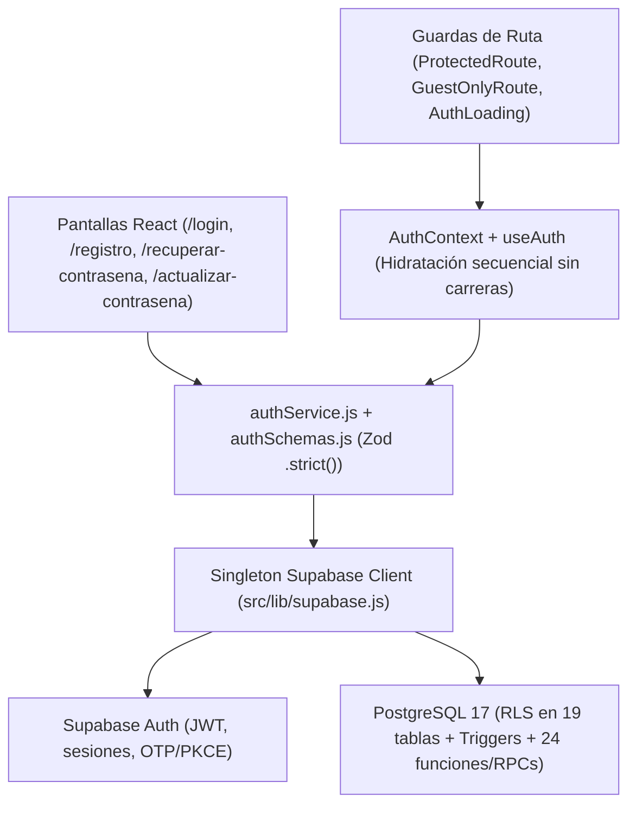

# Implementación de la Etapa 3 — Seguridad, Autenticación y Control de Acceso
## FORJA BRAVA — SIGR (Sistema Integral de Gestión de Restaurante)

**Estado:** Implementado en repositorio local (pendiente de aplicación autorizada de migración correctiva `07` y configuración manual de URLs de redirección en Supabase Dashboard).  
**Stack involucrado:** React 19 · Vite 8 · Tailwind CSS v4 · React Router 7 · Zod 4 · `@supabase/supabase-js` v2 · PostgreSQL 17 (RLS + Triggers + RPCs `SECURITY DEFINER`).

---

## 1. Arquitectura general de autenticación y autorización

La seguridad de **FORJA BRAVA — SIGR** opera bajo un modelo de **defensa en profundidad** donde el frontend adapta la interfaz y protege la navegación, mientras **Supabase Auth y PostgreSQL continúan siendo la autoridad final sobre la identidad y el acceso a los datos**:



Principios aplicados:
- **Cero secretos en el navegador:** únicamente clave pública/publishable en variables `VITE_*`.
- **Denegación por defecto:** si falla la verificación del perfil o del rol en PostgreSQL, se invalida la sesión local y se bloquea el acceso a rutas privadas.
- **Fuente única de rol:** el rol efectivo proviene exclusivamente de `public.profiles` unido a `public.roles (id, code, name)` en PostgreSQL; jamás de formularios, `localStorage`, query strings ni estado manipulable.

---

## 2. Configuración del cliente Supabase y validación de entorno

### 2.1. Validación de entorno (`src/lib/env.js`)
- `validateRuntimeEnv()` valida con Zod la presencia de `VITE_SUPABASE_URL` y `VITE_SUPABASE_ANON_KEY`, además de comprobar que `VITE_SUPABASE_URL` utilice protocolo `https:` o `http:` válido.
- Exporta `env`, `isSupabaseConfigured`, `supabaseConfigErrors` y `assertSupabaseConfigured()`.
- Nunca imprime ni concatena valores de claves o URLs en mensajes de error ni en consola.

### 2.2. Instancia única de Supabase (`src/lib/supabase.js`)
- Inicializa un único cliente `supabase` en todo el navegador con:
  - `persistSession: true`
  - `autoRefreshToken: true`
  - `detectSessionInUrl: true`
- Incluye `getAuthRedirectUrl(internalPath)`, que construye URLs basadas en `window.location.origin` aceptando únicamente rutas internas que comiencen con `/` y rechazando rutas protocolo-relativas (`//...`) o absolutas externas.

---

## 3. Flujo de registro de clientes (`/registro`)

1. `RegisterPage.jsx` captura `fullName`, `email`, `phone` (opcional), `password` y `confirmPassword`. **No existe selector ni campo de rol.**
2. `registerSchema` (`src/schemas/authSchemas.js`) aplica `.strict()` para rechazar cualquier propiedad adicional inyectada (como `role` o `is_active`), normaliza el correo a minúsculas, exige mínimo 8 caracteres con letras y números y verifica coincidencia exacta de contraseñas.
3. `registerClientAccount()` (`src/services/authService.js`) invoca `supabase.auth.signUp()` enviando en `options.data` únicamente `full_name` y `phone`, con `emailRedirectTo: getAuthRedirectUrl('/login')`.
4. En PostgreSQL, el trigger `on_auth_user_created` (`public.handle_new_auth_user`) crea automáticamente la fila en `public.profiles` asignando de forma fija el rol `cliente` y `is_active = true`.
5. Soporta tanto proyectos con confirmación de correo habilitada (mostrando aviso claro de revisión de bandeja, incluyendo el caso `identities.length === 0` sin filtrar existencia previa) como inicio inmediato de sesión si la confirmación estuviera desactivada en entorno de desarrollo.

---

## 4. Flujo de inicio de sesión (`/login`)

1. `LoginPage.jsx` valida formato con `loginSchema` y llama a `signInWithEmailPassword()`.
2. Tras `supabase.auth.signInWithPassword()`, el servicio consulta inmediatamente `fetchAuthenticatedProfile(user.id)` contra `public.profiles` y `public.roles`.
3. Si `profiles.is_active === false`, o si el perfil/rol no puede verificarse, el servicio ejecuta `supabase.auth.signOut()` de inmediato y retorna el error normalizado correspondiente (`ACCOUNT_DISABLED` o `AUTHORIZATION_FAILED`).
4. Si el perfil está activo y el rol es válido (`cliente`, `mesero` o `administrador`), `resolvePostAuthRedirect(redirectParam, role)` calcula el destino seguro evitando Open Redirects, bucles hacia rutas de autenticación y accesos cruzados entre roles.

---

## 5. Flujo de recuperación y actualización de contraseña

### 5.1. Solicitud (`/recuperar-contrasena`)
- `ForgotPasswordPage.jsx` valida el correo con `forgotPasswordSchema` y ejecuta `requestPasswordResetEmail()`, que invoca `supabase.auth.resetPasswordForEmail(email, { redirectTo: getAuthRedirectUrl('/actualizar-contrasena') })`.
- Devuelve siempre un **mensaje neutral contra enumeración de usuarios**, reportando errores únicamente ante fallos de red o límites de tasa (`rate_limit`).

### 5.2. Restablecimiento (`/actualizar-contrasena`)
- `ResetPasswordPage.jsx` y `verifyRecoverySessionFromUrl()` soportan los tres mecanismos utilizados por Supabase v2:
  1. Hash implícito detectado en URL (`PASSWORD_RECOVERY` / sesión activa).
  2. Parámetros OTP (`?token_hash=...&type=recovery` mediante `verifyOtp`).
  3. Intercambio PKCE (`?code=...` mediante `exchangeCodeForSession`).
- Si el enlace expiró o fue manipulado, muestra alerta clara y enlace directo para solicitar uno nuevo.
- Al guardar la nueva contraseña validada con `resetPasswordSchema`, ejecuta `supabase.auth.updateUser({ password })`, cierra la sesión temporal de recuperación y redirige a `/login`.

---

## 6. Gestión de sesión e hidratación (`AuthContext` y `useAuth`)

Implementados en `src/context/authContextInstance.js`, `src/context/AuthContext.jsx` y `src/hooks/useAuth.js`:
- Estructura expuesta:
  ```javascript
  {
    user,
    session,
    profile,
    role,
    isAuthenticated,
    isLoading,
    isActive,
    authNotice,
    isRecoveryMode,
    signIn,
    signUp,
    signOut,
    requestPasswordReset,
    updatePassword,
    updateProfile,
    refreshProfile,
    hasRole,
    can,
  }
  ```
- **Prevención de condiciones de carrera:** `hydrateFromSession` utiliza un contador monotónico (`requestSeqRef`) y la bandera `initialResolved` entre `getSession()` y `onAuthStateChange()`, descartando respuestas obsoletas si ocurre un cierre o cambio de sesión en paralelo.

---

## 7. Estructura real del perfil autenticado

Alineada estrictamente con `supabase/migrations/20261123221001_extensions_and_access_schema.sql`:
- Tabla `public.profiles`: `id`, `role_id`, `full_name`, `email`, `phone`, `is_active`, `created_at`, `updated_at`.
- Relación `public.roles`: `id`, `code` (`'cliente' | 'mesero' | 'administrador'`), `name`.
- Dado que las tablas `permissions` y `role_permissions` restringen `SELECT` a `public.is_admin()` por diseño RLS, el frontend **no relaja dichas políticas**: obtiene el rol real desde `profiles -> roles` y deja la validación granular en PostgreSQL.
- La edición de perfil propio (`updateOwnBasicProfile`) actualiza exclusivamente `full_name` y `phone`. Cualquier intento de alterar `id`, `role_id`, `is_active` o `email` está bloqueado en PostgreSQL por el trigger `protect_profile_privileged_fields` (que además impide eliminar o desactivar al último administrador activo).

---

## 8. Gestión de roles y matriz de autorización (`src/utils/rbac.js`)

| Funcionalidad | Cliente (`cliente`) | Mesero (`mesero`) | Administrador (`administrador`) |
|---|---|---|---|
| Consultar menú público y ajustes visibles | Sí | Sí | Sí |
| Gestionar perfil básico propio (`full_name`, `phone`) | Sí | Sí | Sí |
| Consultar pedidos | Solo propios (RLS) | Modalidad `mesa` (RLS) | Todos (RLS) |
| Crear pedidos | Domicilio / Recoger (`create_order`) | Comandas de mesa (`create_table_order` / `create_order`) | Todas las modalidades |
| Gestionar inventario de mesas | No | Lectura operativa y solicitud de cierre de cuenta | CRUD completo (`is_admin()`) |
| Gestionar reservas | Crear y cancelar propias dentro de ventana | Lectura operativa de ocupación | Gestión completa |
| Gestionar productos y categorías | No | No | Sí (`is_admin()`) |
| Gestionar usuarios y roles | No | No | Sí (`admin_update_user_access`) |
| Gestionar caja y reembolsos | No | No (sin acceso financiero, D-05) | Exclusivo (`open_cash_session`, `close_cash_session`, `refund_order_payment`, `settle_table_account`) |
| Consultar reportes y auditoría | No | No | Exclusivo (`audit_logs`, `cash_sessions`) |

---

## 9. Protección de rutas y despliegue SPA

- `ProtectedRoute.jsx`:
  1. Muestra `AuthLoading` mientras `isLoading === true` (nunca renderiza contenido privado de forma transitoria).
  2. Verifica simultáneamente `isAuthenticated`, `user`, `profile`, `isActive` y `role`.
  3. Redirige a `/login?redirect=<ruta>` cuando no hay sesión válida.
  4. Redirige a `/acceso-denegado` (`403`) cuando el rol autenticado no pertenece a `allowedRoles`.
- `GuestOnlyRoute.jsx`:
  - Redirige a usuarios ya autenticados desde `/login` o `/registro` hacia su ruta autorizada (`/cliente`, `/mesero` o `/admin`) sin producir bucles.
- Segmentación en `src/routes/AppRouter.jsx`:
  - Públicas: `/`, `/recuperar-contrasena`, `/actualizar-contrasena`, `/acceso-denegado`.
  - Solo invitados: `/login`, `/registro`.
  - Privadas por rol: `/cliente/*` (`cliente`), `/mesero/*` (`mesero`), `/admin/*` (`administrador`).
- `vercel.json`:
  - Publica exclusivamente `dist/`, redirige `/admin.html` -> `/admin`, configura rewrite SPA `/(.*)` -> `/index.html` e inyecta cabeceras de seguridad (`X-Content-Type-Options: nosniff`, `X-Frame-Options: DENY`, `Referrer-Policy: strict-origin-when-cross-origin`, `Permissions-Policy`).

---

## 10. Seguridad RLS y hallazgo correctivo en base de datos

Durante la verificación de solo lectura contra el proyecto remoto de Supabase se comprobó que:
1. Las 19 tablas tienen RLS activo (`20261123221004_rls_policies_and_storage.sql`).
2. Sin embargo, al haberse aplicado las migraciones 01..06 vía CLI sin `GRANT` explícitos de tabla para los roles `anon` y `authenticated`, PostgreSQL rechaza las consultas directas de PostgREST con `42501: permission denied for table ...` antes de evaluar las políticas RLS.
3. Siguiendo estrictamente la regla de **no editar migraciones ya aplicadas ni ejecutar migraciones remotas sin autorización**, se creó la migración aditiva de menor privilegio:
   - `supabase/migrations/20261124210007_least_privilege_table_grants.sql`
   - Concede `SELECT` a `anon` **únicamente** en `categories`, `products`, `product_complements` y `restaurant_settings`.
   - Concede a `authenticated` únicamente los privilegios exactos previstos por las políticas RLS existentes, manteniendo `orders`, `order_items`, `order_status_history`, `payments`, `table_accounts`, `cash_sessions`, `cash_movements` y `audit_logs` como solo lectura directa (escritura exclusiva mediante RPCs `SECURITY DEFINER`).

---

## 11. Revisión y verificación de funciones RPC

Se inspeccionaron las 24 funciones SQL definidas en las migraciones `01`, `03` y `05` y se verificó en vivo contra Supabase que:
- Todas las funciones `SECURITY DEFINER` fijan `SET search_path = public, pg_temp`.
- Las funciones internas (`set_updated_at`, `handle_new_auth_user`, `protect_profile_privileged_fields`, `log_audit_event`, `recalculate_table_account_total`, `sync_table_status`, etc.) tienen `REVOKE ALL FROM PUBLIC, anon, authenticated` (confirmado en vivo: `anon` no puede invocar `log_audit_event`).
- Las RPCs operativas (`create_order`, `create_table_order`, `transition_order_status`, `open_cash_session`, `record_cash_movement`, `close_cash_session`, `refund_order_payment`, `settle_table_account`, `admin_update_user_access`, etc.) rechazan invocaciones de `anon` (`42501` / `PGRST202`) y validan internamente `auth.uid()`, `is_active = true` y rol efectivo (`current_user_role()`, `is_admin()`, `is_waiter()`).
- La RPC pública `get_available_reservation_slots(p_date, p_party_size, p_zone)` responde correctamente (`ok: true`) para usuarios no autenticados sin exponer tablas internas.

---

## 12. Manejo de cuentas desactivadas (`profiles.is_active = false`)

Control aplicado en tres niveles simultáneos:
1. **En inicio de sesión (`signInWithEmailPassword`):** si `is_active === false`, cierra inmediatamente la sesión recién creada en Supabase Auth y devuelve el mensaje de cuenta desactivada.
2. **En hidratación / sesión persistida (`AuthContext`):** si una cuenta activa pasa a `is_active === false`, al hidratar o refrescar perfil se limpia el estado privado, se invoca `supabase.auth.signOut()` una sola vez (protegido por `signingOutDisabledRef` contra bucles) y se publica `authNotice`.
3. **En PostgreSQL (`current_user_role()` y RPCs):** `current_user_role()` filtra `WHERE p.id = auth.uid() AND p.is_active = true`, por lo que un usuario desactivado pierde instantáneamente su rol efectivo tanto en políticas RLS como en todas las funciones RPC.

---

## 13. Tratamiento de archivos legacy y credenciales de demostración

- `admin.html`: se eliminaron los valores hardcodeados `admin@forjabrava.com` y `Admin123*`, reemplazando el acceso simulado por redirección inmediata hacia `/login`.
- `js/admin.js`: se eliminó la validación local de credenciales y el bypass `sessionStorage.getItem('forja-admin') === '1'`; limpia claves residuales y redirige a `/login`.
- `js/app.js`: se retiró el sistema paralelo de cuentas demo en `localStorage` (`forja-clientes-demo`, `forja-cliente-session`) y los disparadores `.account-trigger` redirigen a `/login`.
- El build productivo de Vite genera `dist/` exclusivamente desde `index.html` y `src/`, sin incluir `admin.html`, `js/admin.js` ni `js/app.js`.

---

## 14. Variables de entorno requeridas

Archivo local `.env` (excluido en `.gitignore`; referencia pública en `.env.example`):

| Variable | Obligatoria | Uso |
|---|---|---|
| `VITE_SUPABASE_URL` | Sí | URL HTTPS del proyecto Supabase. |
| `VITE_SUPABASE_ANON_KEY` | Sí | Clave pública (`anon` / `publishable`) de Supabase. |
| `VITE_APP_NAME` | Opcional | Nombre visible de la aplicación (`FORJA BRAVA — SIGR`). |
| `VITE_APP_TIMEZONE` | Opcional | Zona horaria operativa (`America/Bogota`). |

> [!CAUTION]
> Nunca agregar `SUPABASE_SERVICE_ROLE_KEY` ni claves privadas de base de datos en archivos `.env` consumidos por Vite ni con el prefijo `VITE_`.

---

## 15. Configuraciones manuales pendientes

1. **Aplicar la migración correctiva `07` en Supabase remoto (requiere autorización del propietario):**
   - Revisar `supabase/migrations/20261124210007_least_privilege_table_grants.sql` y ejecutar `npx supabase db push` cuando se autorice, para habilitar los `GRANT` mínimos de tabla requeridos por PostgREST bajo RLS.
2. **Configuración en Supabase Dashboard → Authentication → URL Configuration:**
   - **Site URL:** URL principal de despliegue en Vercel (o `http://localhost:5173` durante desarrollo local).
   - **Redirect URLs permitidas:**
     - `http://localhost:5173/login`
     - `http://localhost:5173/actualizar-contrasena`
     - `http://localhost:4173/login`
     - `http://localhost:4173/actualizar-contrasena`
     - `https://<dominio-vercel-produccion>/login`
     - `https://<dominio-vercel-produccion>/actualizar-contrasena`
3. **Plantillas de correo (Supabase Dashboard → Authentication → Email Templates):**
   - Verificar que **Confirm signup** y **Reset Password** utilicen `{{ .RedirectTo }}` (o `?token_hash={{ .TokenHash }}&type=recovery` apuntando a `/actualizar-contrasena`, ambos soportados por `ResetPasswordPage.jsx`).
4. **Provisión inicial de cuentas internas (`administrador` y `mesero`) y pruebas autenticadas reales:**
   - Crear las cuentas internas en Supabase Auth y asignar su rol inicial de `administrador` desde consola SQL segura de Supabase (posteriormente gestionables vía RPC `admin_update_user_access`), permitiendo ejecutar las pruebas E2E autenticadas reales por rol contra el entorno remoto.
5. **Variables de entorno en Vercel y GitHub Actions:**
   - Registrar `VITE_SUPABASE_URL` y `VITE_SUPABASE_ANON_KEY` en *Project Settings → Environment Variables* de Vercel y en *Repository Secrets* de GitHub si el pipeline ejecuta build/tests.

---

## 16. Decisiones técnicas relevantes

1. **Separación de `authContextInstance.js` y `AuthContext.jsx`:** garantiza compatibilidad total con Vite Fast Refresh y React 19 Compiler (`eslint-plugin-react-hooks` v7) con cero advertencias de lint.
2. **No relajación de RLS en `permissions` / `role_permissions`:** se mantuvo intacta la restricción administrativa de lectura sobre catálogos internos de permisos y se derivó la navegación del frontend a partir de `roles.code` autenticado.
3. **Soporte híbrido de enlaces de recuperación (Implícito + PKCE + `token_hash`):** evita roturas independientemente de si la plantilla de correo de Supabase usa PKCE por defecto o `verifyOtp`.
