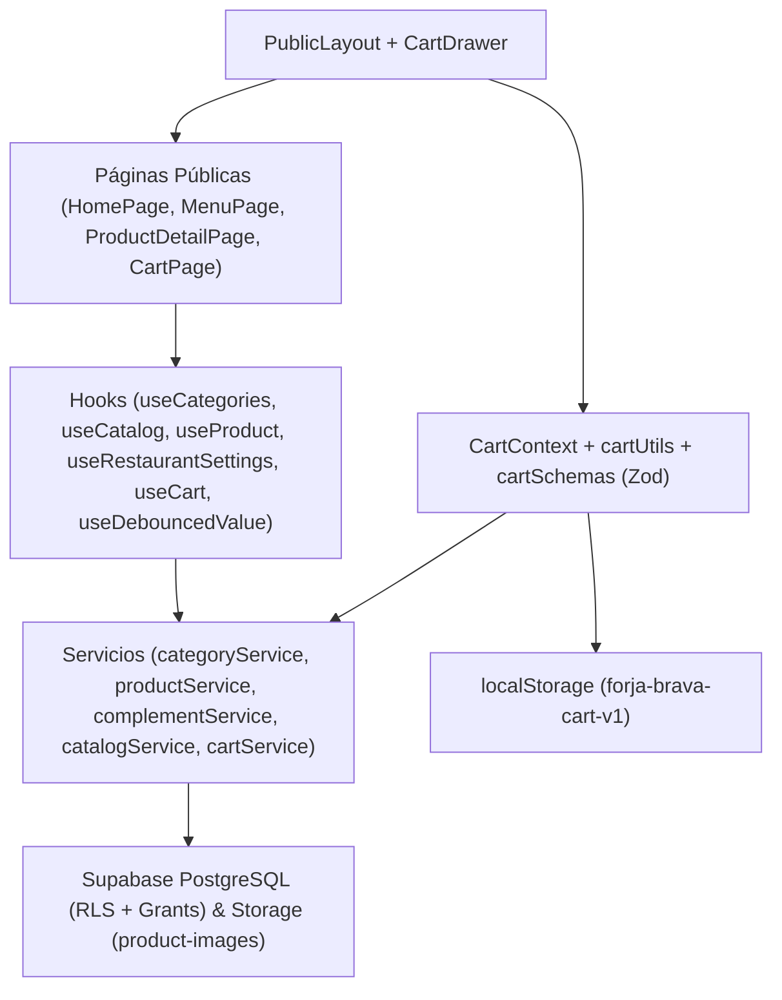

# Implementación de la Etapa 5 — Sitio Público y Catálogo Dinámico
## FORJA BRAVA — SIGR (Sistema Integral de Gestión de Restaurante)

**Estado:** COMPLETADO (conectado a Supabase real, probado con Vitest + Playwright y validado con `lint` y `build`).  
**Stack:** React 19 · Vite 8 · Tailwind CSS v4 · React Router 7 · Zod 4 · `@supabase/supabase-js` v2 · PostgreSQL 17 (RLS + `GRANT` mínimos de Migración 07) · Supabase Storage (`product-images`).

---

## 1. Objetivo

Entregar el sitio público completo de **FORJA BRAVA** conectado en vivo a Supabase para que cualquier visitante pueda explorar la identidad del restaurante, consultar categorías activas y productos disponibles, filtrar y buscar en la carta, revisar detalles, seleccionar complementos reales y gestionar un carrito persistente con validación contra la base de datos.

---

## 2. Arquitectura implementada

---

## 3. Componentes creados y reutilizados

- **Nuevos componentes de dominio público y carrito:**
  - `src/components/public/ProductImage.jsx`: carga segura de imágenes con resolución híbrida (`https://`, activos locales de semilla y bucket `product-images`) y estado visual de respaldo (*Imagen no disponible*).
  - `src/components/public/ProductCard.jsx`: tarjeta editorial de producto con categoría, etiqueta, disponibilidad, precio, enlace a detalle y botón rápido *Agregar* únicamente cuando el producto está disponible y no tiene complementos personalizables.
  - `src/components/cart/CartDrawer.jsx`: panel lateral deslizable con resumen de líneas, complementos, controles de cantidad, alertas de sincronización y enlace a `/carrito`.
- **Componentes reutilizados de la Etapa 4:** `Button`, `IconButton`, `Badge`, `Card`, `Drawer`, `ConfirmDialog`, `SearchInput`, `Select`, `Radio`, `EmptyState`, `LoadingState`, `ErrorState`, `SkeletonCard`, `OfflineBanner`, `PageHeader`, `ContentContainer` y `BrandLogo`.

---

## 4. Servicios y utilidades creados

- `src/services/categoryService.js`: consulta de categorías activas ordenadas por `display_order` y `name`.
- `src/services/productService.js`: consulta de productos públicos con búsqueda (`ilike`), ordenamiento (`featured`, `price_asc`, `price_desc`, `name_asc`), consulta por `slug` y consulta por lote de IDs (`in`).
- `src/services/complementService.js`: consulta individual (`fetchComplementsForProduct`) y por lote sin N+1 (`fetchComplementsMapForProducts`) sobre `product_complements` + `products` (`is_addon = true`, `is_available = true`).
- `src/services/catalogService.js`: lectura de `restaurant_settings` (incluyendo `featured_product_id`, horarios, ubicación, teléfono y `allow_client_table_orders`) y carga paralela de la landing (`fetchLandingData`).
- `src/services/cartService.js`: persistencia versionada y validación Zod en `localStorage` + reconciliación en vivo contra Supabase (`syncCartWithSupabase`).
- `src/utils/cartUtils.js`, `src/schemas/cartSchemas.js` y `src/utils/resolveProductImage.js`.

---

## 5. Rutas implementadas

Todas servidas bajo `PublicLayout` sin requerir autenticación (respetando **D-06**: libre navegación del catálogo, autenticación obligatoria solo para confirmar pedidos o reservas):

| Ruta | Vista | Descripción |
|---|---|---|
| `/` | `HomePage` | Hero editorial, categorías activas desde Supabase, productos destacados, producto protagonista (`featured_product_id`), propuesta gastronómica y contacto/horarios desde `restaurant_settings`. |
| `/menu` | `MenuPage` | Catálogo dinámico completo con búsqueda con debounce, filtro de disponibilidad, ordenamiento y sincronización de filtros en query params (`?q=&sort=&disp=`). |
| `/menu/:category` | `MenuPage` | Catálogo filtrado por `slug` de categoría activa, mostrando título y descripción de la categoría. |
| `/producto/:slug` | `ProductDetailPage` | Detalle completo del producto, ingredientes, disponibilidad, complementos dinámicos, selector de cantidad (`1..99`) y cálculo transparente del total. |
| `/carrito` | `CartPage` | Vista completa del carrito, validación en vivo contra la carta, selector de modalidad preparado (con *Mesa* bloqueada mientras `allow_client_table_orders === false`) y transición hacia `/login?redirect=%2Fcarrito` si no hay sesión. |

---

## 6. Consultas a Supabase y seguridad

- Todas las consultas usan únicamente el cliente singleton (`src/lib/supabase.js`) con clave pública (`VITE_SUPABASE_ANON_KEY`) y cero `service_role`.
- Solo se ejecutan lecturas `SELECT` sobre las 4 tablas públicas permitidas por RLS y la Migración `07`: `categories`, `products`, `product_complements` y `restaurant_settings`.
- Comprobación en vivo ejecutada contra el proyecto remoto antes de la implementación: `4` categorías activas, `13` productos disponibles, `12` relaciones en `product_complements` y `1` fila en `restaurant_settings`.
- Los cálculos del frontend son exclusivamente informativos; los precios definitivos, complementos y disponibilidad volverán a validarse en servidor mediante la RPC `create_order` en la etapa de checkout.

---

## 7. Funcionamiento del catálogo y complementos

- Los productos se relacionan con sus categorías reales (`categories.is_active = true`) y sus complementos mediante `product_complements (product_id, complement_id)`.
- Fórmula de cálculo aplicada en `cartUtils.js`:
  - `valorUnitario = precioBase + suma(complementosSeleccionados)`
  - `totalLinea = valorUnitario × cantidad`
- Las líneas solo se agrupan cuando coinciden `productId` y el conjunto exacto de IDs de complementos (independientemente del orden de selección); configuraciones distintas se mantienen como líneas independientes.

---

## 8. Arquitectura y persistencia del carrito

- Estado global centralizado en `CartContext.jsx` + `useCart.js`, persistido bajo la clave versionada `forja-brava-cart-v1` en `localStorage` y validado con `persistedCartSchema` (Zod).
- Ante datos corruptos o versiones incompatibles en `localStorage`, se descarta el valor inválido sin romper la aplicación.
- Al iniciar la aplicación con ítems persistidos (o al pulsar *Validar carta* en `/carrito`), `syncCartWithSupabase()` verifica cada producto y complemento contra Supabase:
  - Si un precio cambió, actualiza al valor vigente y avisa al usuario.
  - Si un producto o complemento dejó de estar disponible, marca la línea como *No disponible*, la excluye del subtotal e impide avanzar hasta que se retire.

---

## 9. Pruebas ejecutadas y resultados reales

| Suite / Comando | Resultado | Cobertura |
|---|---|---|
| `npm run lint` | **0 errores, 0 advertencias** | Reglas ESLint + React 19 Compiler. |
| `npm test` (Vitest) | **7 archivos · `48 / 48` aprobadas** | Incluye `cartUtilsAndService.test.js` (6 suites de cálculo, agrupación, persistencia y reconciliación), `publicCatalogAndCart.test.jsx` (3 suites de catálogo/detalle/errores) + regresión completa de Etapas 3 y 4. |
| `npm run build` | **Exitoso (`1.88 s`)** | `2,389` módulos transformados en `dist/`. |
| `npm run test:e2e` (Playwright) | **`16 / 16` aprobadas (`24.4 s`)** | Cubre los 18 escenarios E2E de la Etapa 5 (`public-catalog-cart.spec.js`, incluyendo desktop `1366 px` y móvil `360/390 px` sin desbordamiento) + regresión completa de Etapas 3 y 4. |

---

## 10. Limitaciones identificadas del esquema actual

1. **Complementos obligatorios y límites mínimo/máximo por grupo:** la tabla `public.product_complements` actual almacena pares `(product_id, complement_id)` sin columnas `is_required`, `min_select` ni `max_select`. En consecuencia, todos los complementos se presentan como selección opcional múltiple fiel al esquema real; si en el futuro el negocio exige complementos obligatorios (ej. término de carne o bebida obligatoria), bastará agregar una migración aditiva sobre `product_complements`.
2. **Galería multi-imagen:** la tabla `public.products` dispone actualmente de una única columna `image_url` (no existe tabla `product_images`), por lo que el detalle muestra la imagen principal con respaldo accesible si falta.
3. **Productos agotados bajo RLS público (`anon`):** la política `products_select_public` filtra `is_available = true` para `anon`, por lo que los productos agotados no se listan en `/menu` para visitantes anónimos, mientras que si un producto en el carrito persistido pasa a agotado, `syncCartWithSupabase` lo detecta automáticamente y bloquea el avance.

---

## 11. Pendientes para la siguiente etapa

1. Implementar el flujo transaccional de Checkout (Etapa 6) conectado a la RPC `public.create_order`, libreta de direcciones (`customer_addresses`), tarifa fija de domicilio (`restaurant_settings.fixed_delivery_fee`) y pagos simulados.
2. Implementar el flujo de Reservas públicas y de cliente conectado a `get_available_reservation_slots`, `create_reservation` y `cancel_reservation`.
3. Optimizar el tamaño del bundle mediante `React.lazy()` por ruta y conversión de imágenes PNG a WebP.
