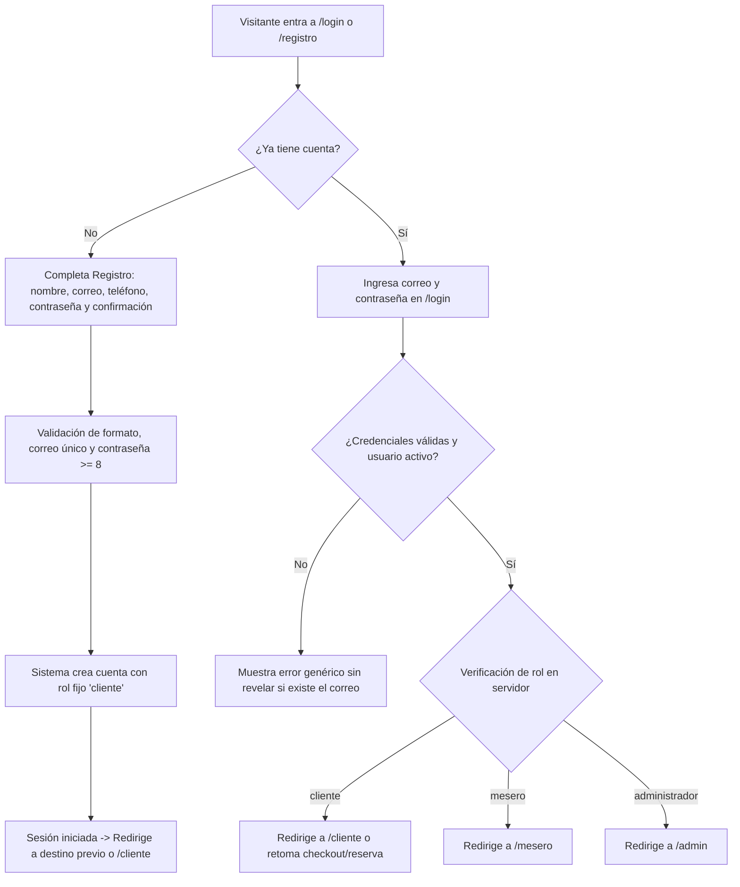
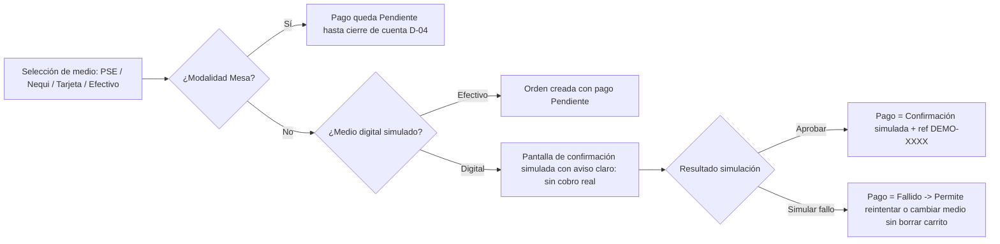

# Flujos Funcionales de Extremo a Extremo
## FORJA BRAVA — SIGR

Este documento especifica los flujos operativos completos del sistema incorporando las decisiones oficiales **D-01 a D-06**, las tres modalidades de pedido, los pagos simulados y la matriz de permisos entre **Cliente**, **Mesero** y **Administrador**.

---

## 1. Matriz de roles, estados y permisos

### 1.1. Estados oficiales de pedido y transiciones permitidas

| Estado | Descripción | Quién puede establecerlo | Modalidades aplicables |
|---|---|---|---|
| `Pendiente` | Pedido recién registrado en el sistema | Sistema (al crear pedido) | Domicilio, Recoger, Mesa |
| `Confirmado` | Pedido aceptado por cocina / administración | **Administrador** | Domicilio, Recoger, Mesa |
| `En preparación` | En cocina / parrilla | **Administrador** | Domicilio, Recoger, Mesa |
| `Listo` | Preparado y listo para recoger, despachar o servir | **Administrador** | Domicilio, Recoger, Mesa |
| `Despachado` | Entregado al domiciliario / en camino | **Administrador** | Solo **Domicilio** |
| `Entregado` | Recibido por el cliente o servido en mesa | **Administrador** o **Mesero** (D-05, en pedidos de mesa) | Domicilio, Recoger, Mesa |
| `Cancelado` | Pedido anulado (no suma en ventas entregadas) | **Administrador** (cualquier estado previo a cierre) o **Mesero** (D-05, **solo si está en `Pendiente`**, antes de entrar a preparación) | Domicilio, Recoger, Mesa |

### 1.2. Estados de pago simulado (independientes del estado de preparación)

| Estado de pago | Cuándo aplica |
|---|---|
| `Pendiente` | Pedidos `En mesa` (hasta el cierre de cuenta, D-04) o pagos `Efectivo` contra entrega/recogida. |
| `Confirmación simulada` | Checkout con pago simulado exitoso (`PSE`, `Nequi`, `Tarjeta`) o cierre de cuenta de mesa cobrado en caja. |
| `Fallido` | Simulación explícita de fallo de pago (permite reintentar sin perder el carrito). |
| `Reembolsado` | Reverso simulado registrado por el administrador tras cancelación de un pedido previamente pagado. |

---

## 2. Flujo 1: Registro e inicio de sesión (Roles: Cliente, Mesero, Administrador)

**Reglas clave:**
- El registro público **solo** crea cuentas con rol `cliente`. Las cuentas de `mesero` y `administrador` son gestionadas únicamente por un administrador autorizado.
- Si el usuario intentaba ir a Checkout o Reservas sin sesión (D-06), tras autenticarse regresa automáticamente a ese flujo conservando el contenido de su carrito.

---

## 3. Flujo 2: Pedido a domicilio

1. El visitante explora el menú público (`PUB-02`), opcionalmente abre el **Detalle de producto** (`PUB-03`) para añadir complementos y observaciones, y suma ítems al **Carrito** (`PUB-04`).
2. Pulsa **IR AL CHECKOUT**.
3. **Compuerta D-06:** Si no ha iniciado sesión, el sistema lo dirige a `CLI-01` (`/login`) conservando `forja-cart`. Al autenticarse vuelve al Paso 1 del checkout.
4. **Paso 1 (Revisión):** Verifica productos, cantidades, complementos explícitos, observaciones y subtotal.
5. **Paso 2 (Modalidad):** Selecciona **Domicilio**.
6. **Paso 3 (Servicio):** Se pre-llenan nombre, correo y teléfono desde su perfil. Elige una dirección guardada o ingresa dirección completa, barrio e indicaciones. El sistema suma la **tarifa fija de domicilio** configurada (D-03).
7. **Paso 4 (Pago simulado):** Elige medio (`PSE`, `Nequi`, `Tarjeta`, `Efectivo`).
   - Si elige medio digital simulado: ejecuta el Flujo 5 (Pago simulado).
   - Si elige `Efectivo`: registra pago en estado `Pendiente` (pago contra entrega).
8. **Paso 5 (Confirmación):** El sistema crea el pedido en estado `Pendiente`, limpia el carrito inmediatamente, muestra el comprobante imprimible (`FB-...`) y habilita el acceso directo a **Seguimiento** (`CLI-07`).

---

## 4. Flujo 3: Pedido para recoger en restaurante

1. Mismos pasos 1 a 4 del Flujo 2 (con compuerta de inicio de sesión D-06).
2. **Paso 2 (Modalidad):** Selecciona **Recoger en restaurante**.
3. **Paso 3 (Servicio):** Confirma nombre y teléfono pre-llenados, visualiza la dirección real del restaurante y selecciona hora estimada de recogida (si aplica). Tarifa de domicilio = `$0`.
4. **Paso 4 (Pago simulado):** Selecciona `PSE`, `Nequi`, `Tarjeta` (simulación inmediata) o `Efectivo` (pago al recoger, estado `Pendiente`).
5. **Paso 5 (Confirmación):** Se crea el pedido en estado `Pendiente`, se limpia el carrito y se muestra el comprobante imprimible con código de recogida.

---

## 5. Flujo 4: Pedido en mesa (Vía Mesero o Cliente)

### 5.1. Vía Mesero (Operación principal en salón)
1. El mesero inicia sesión y entra a **Mesas** (`MES-02`).
2. Selecciona una mesa `Disponible` o `Ocupada` (con cuenta abierta) o con `Reserva` del cliente presente.
3. Abre **Nuevo pedido** (`MES-03`) asociado a esa `mesa_id`.
4. Busca o filtra productos por categoría, ajusta cantidades, añade complementos y escribe observaciones de cocina.
5. Confirma la comanda:
   - La mesa pasa a estado `Ocupada` (si estaba `Disponible` o `Reservada`).
   - Se registra el pedido con modalidad `Mesa`, estado de preparación `Pendiente` y **estado de pago `Pendiente`** (D-04).
   - Si la mesa ya tenía pedidos previos sin cerrar, el nuevo pedido se **acumula** a la misma cuenta activa de la mesa.
6. El pedido aparece en el panel del **Administrador** (`ADM-05`) para gestionar su preparación.

### 5.2. Vía Cliente en restaurante (Checkout modalidad Mesa)
1. El cliente autenticado (D-06) arma su carrito y en el **Paso 2** del checkout selecciona **Consumir en mesa**.
2. En el **Paso 3**, selecciona su mesa disponible o su reserva activa validada por el sistema y número de personas.
3. En el **Paso 4**, el sistema informa conforme a **D-04** que el pago queda en estado **`Pendiente` hasta el cierre de cuenta de la mesa** (puede preseleccionar medio de pago de referencia si aplica, sin cobro inmediato).
4. En el **Paso 5**, se confirma la comanda y se acumula a la cuenta de la mesa.

---

## 6. Flujo 5: Pago simulado

**Regla de seguridad:** El monto a pagar siempre se calcula a partir de los precios vigentes en el catálogo del servidor más la tarifa fija de domicilio (si aplica), nunca confiando en precios editados en el navegador.

---

## 7. Flujo 6: Cierre de cuenta de mesa (D-04)

1. Cuando los comensales piden la cuenta, el **Mesero** entra a la **Cuenta activa de la mesa** (`MES-05`).
2. Revisa todos los pedidos acumulados de la mesa (excluyendo los `Cancelados`) y el total consolidado.
3. Pulsa **Solicitar cierre de cuenta** (la cuenta pasa a estado *Por cobrar* y genera resumen imprimible para el cliente).
4. El **Administrador / Caja** (`ADM-09`) recibe la cuenta pendiente de cobro, selecciona el medio de pago final (`Efectivo`, `Tarjeta`, `Nequi`, `PSE`), registra el pago simulado como `Confirmación simulada` y vincula el ingreso al turno de caja abierto.
5. Al confirmarse el cobro:
   - Todos los pedidos de esa cuenta quedan con pago `Confirmación simulada`.
   - La mesa pasa automáticamente a estado **`Disponible`** (salvo que tenga una reserva inminente).
   - El monto se contabiliza exactamente una vez en Caja según su método de pago (efectivo vs. digital).

---

## 8. Flujo 7: Reserva automática con disponibilidad (D-01, D-02, D-06)

1. El cliente accede a **Reservas** (`PUB-05`). Si no ha iniciado sesión, el sistema solicita autenticación (D-06).
2. Selecciona **Fecha** (en hora local `America/Bogota`, no en el pasado), **Número de personas** (`>= 1`) y opcionalmente **Zona preferida**.
3. El sistema consulta la configuración vigente:
   - Horario de atención del día seleccionado.
   - **Duración configurable del turno de reserva** (D-02).
   - **Inventario de mesas activas** con `capacidad >= personas` (D-01).
   - Reservas existentes no canceladas que se solapen con cada intervalo `[hora_inicio, hora_inicio + duracion]`.
4. Se muestran únicamente los **horarios con al menos una mesa compatible libre**.
5. El cliente elige un horario, añade observaciones opcionales y pulsa **Confirmar reserva**.
6. El sistema revalida disponibilidad de forma atómica, asigna automáticamente la mesa adecuada (evitando solapamientos), guarda la reserva con estado **`Confirmada`** automáticamente y muestra el código `RS-...` en pantalla y en **Mis reservas** (`CLI-08`).

---

## 9. Flujo 8: Cancelaciones (Cliente, Mesero y Administrador)

- **Cancelación de pedido por Mesero (D-05):**
  - Permitida **únicamente** cuando el pedido está en estado `Pendiente` (recién registrado, sin haber pasado a `Confirmado` ni `En preparación`).
  - Requiere confirmación en modal y motivo opcional; registra trazabilidad en Auditoría (`ADM-11`).
  - Si el pedido ya avanzó a preparación, el botón `Cancelar` está deshabilitado y bloqueado en servidor.
- **Cancelación de pedido por Administrador:**
  - Puede cancelar pedidos en estados previos a cierre de caja registrando motivo. Si tenía pago `Confirmación simulada`, permite marcar estado de pago como `Reembolsado`.
  - Los pedidos `Cancelado` se excluyen automáticamente de ventas entregadas, cierres de caja y rankings de productos.
- **Cancelación de reserva por Cliente o Administrador:**
  - El cliente puede cancelar su reserva desde `CLI-08` mientras esté en estado `Pendiente` o `Confirmada` y respete la ventana de anticipación configurada.
  - Al cancelarse, la mesa asignada libera inmediatamente ese bloque horario para nuevas reservas.

---

## 10. Flujo 9: Seguimiento de pedido por el cliente

1. El cliente entra a **Mis pedidos** (`CLI-06`) o pulsa **Ver seguimiento** desde el comprobante del checkout.
2. En `CLI-07` visualiza la línea temporal filtrada según la modalidad:
   - **Domicilio:** `Pendiente` → `Confirmado` → `En preparación` → `Listo` → `Despachado` (En camino) → `Entregado`.
   - **Recoger:** `Pendiente` → `Confirmado` → `En preparación` → `Listo` (Listo para recoger) → `Entregado`.
   - **Mesa:** `Pendiente` → `Confirmado` → `En preparación` → `Listo` → `Entregado`.
3. Cada cambio ejecutado por el administrador (o la entrega marcada por el mesero) actualiza la línea temporal y la hora del cambio. El cliente tiene acceso de **solo lectura**.

---

## 11. Flujo 10: Gestión de pedidos por Administrador

1. El administrador abre **Pedidos** (`ADM-05`).
2. Filtra por fecha, estado, modalidad (`Domicilio`, `Recoger`, `Mesa`), cliente o número de pedido.
3. Al abrir un pedido o usar el selector de estado en fila, avanza las etapas de preparación (`Pendiente` → `Confirmado` → `En preparación` → `Listo` → `Despachado` → `Entregado`).
4. El cambio **conserva los filtros activos** en pantalla, registra el evento en el historial de estados y en Auditoría (`ADM-11`), y queda visible para el cliente y el mesero.

---

## 12. Flujo 11: Operaciones autorizadas del Mesero (Resumen de límites D-05)

| Operación | Autorizado para Mesero | Condición / Restricción |
|---|---|---|
| Ver dashboard operativo y mapa de mesas | **Sí** | Solo lectura de inventario; no crea ni elimina mesas. |
| Registrar pedidos en mesa | **Sí** | Solo modalidad `Mesa` con productos activos del catálogo. |
| Consultar pedidos de sus mesas | **Sí** | No accede a pedidos de domicilio ni recoger. |
| Marcar pedido de mesa como `Entregado` | **Sí** | Permitido por D-05 (especialmente cuando el admin lo marca `Listo`). |
| Cancelar pedido recién registrado | **Sí** | Permitido por D-05 **solo si el estado es `Pendiente`** (no en preparación). |
| Cambiar estados de preparación (`Confirmado`, `En preparación`, `Listo`) | **No** | Exclusivo del Administrador. |
| Solicitar cierre de cuenta de mesa | **Sí** | Envía la cuenta acumulada a cobro/cierre en Caja (D-04). |
| Editar precios, productos, categorías, usuarios, caja o reportes | **No** | Bloqueado en interfaz y en políticas de autorización. |
